# My Helper v2 — 架构与系统设计文档

## 1. 设计目标与核心约束

本项目是一个纯 Python 标准库实现的个人与学习 AI Agent。系统以借鉴 Pi 洋葱模型的三层微内核为底座，在 Layer 1 `ai/` 内部落地 **Pi ch04 三层模型调用翻译架构**，在外层按正交协议叠加纯 Markdown 长期记忆、纵深安全沙箱与学习辅导工作流。

核心工程约束：

1. **零第三方运行依赖**：
   - 生产代码仅使用 Python 3.12+ 标准库（`urllib`、`http.client`、`sqlite3`、`threading`、`http.server`、`shlex`、`ipaddress`、`unicodedata` 等）；`pytest` 仅作为开发测试依赖。
2. **三层单向依赖漏斗（`ai ← agent ← assistant`）与 Layer 1 三层解耦**：
   - `personal_assistant/ai/`（Layer 1）：零向上依赖，内部严格遵循 **Pi ch04 三层模型调用翻译架构**：`protocol.py`（第二层·中立事件与契约协议，零内部依赖）← `registry.py`（第一层·统一前台 `stream`/`stream_simple`/`complete` 与通讯录注册表 `ApiProviderRegistry`，零感知具体翻译器）← `providers/`（第三层·共享 `http.py` 传输底座与 `openai_completions`/`openai_reasoning`/`anthropic_messages`/`google_genai` 四大原生翻译器）+ `cache.py`（中立 `Context` 有界 KV Cache 观测）+ `embeddings.py`（标准 `/v1/embeddings` 客户端、小端 `float32` 编解码与 `math.sumprod` 精确余弦）；
   - `personal_assistant/agent/`（Layer 2）：仅依赖 `ai/`，彻底清除 OpenAI 字典渗透（无 `to_openai_schema`/`to_openai_dict`/`extract_tool_calls`）；包含中立 `Context` 驱动的通用 ReAct 循环、纯值对象工具递进扩展（`ToolSchema → Tool` + `bind_tool_context`）与零业务字段 `PluginContext` 统一插件主板（Slot 4 直接复刻 Layer 1 `ApiProvider` 宪法）；
   - `personal_assistant/assistant/`（Layer 3）：个人与学习助手业务编排（零内部依赖底座 `common.py`/`text_search.py`/`files_policy.py`、Markdown 记忆与内置 `LinearRetriever` 兜底、SQLite 会话存储、外层回合预算、后台压缩与 CLI/Web 接入）；
   - 顶层评测包 `evals/` 与 `plugins/`、`tests/` 平级，产品包绝不反向导入 `evals/`，由 [../tests/test_architecture.py](../tests/test_architecture.py) 通过 AST 依赖图（含 `ai/` 内部三层解耦边界）、业务字面量与零 OpenAI 方言扫描、子进程 `sys.modules` 断层隔离测试与四棵目录树（`personal_assistant/`、`plugins/`、`scripts/`、`evals/`）零 `# type: ignore` 硬守卫强制保障。
3. **极简单层 ReAct 内核 + 外层有界预算**：
   - 不引入面向多路并发抢占编码代理的双层插队队列（`steering` / `followUp`），将 [../personal_assistant/agent/react.py](../personal_assistant/agent/react.py) 保持为极简单层 `while True` 循环（`iter_react()` / `run_react()`），仅以 `done.reason != "toolUse" or not assistant_msg.tool_calls` 作为自然终止信号，遇 `StreamError` 透传退出，并提供单步 `convert_to_llm: ContextTransformer` 纯函数边界钩子与执行期 `tool_context` 透传；
   - 生产环境的防死循环与成本上限由 Layer 3 `AssistantApp` 的 `_GuardedTurnLLM`（实现 `ModelInvoker`）在外层实施，既保障运行期有界，又不侵入通用内核。
4. **外层 `Plugin(ABC)` 主板 + 内层五大子协议**：
   - 工具（`Tool`）、检索后端（`RetrieverProtocol`）、配置 DSL 编译器（`ConfigCompilerProtocol`）、协议翻译器（`ApiProvider`）与运行遥测（`ObserverProtocol`）统一继承 `Plugin(ABC)`，在装配期执行单次 `initialize()` 注册进零业务字段的 `PluginContext` 五大强类型插槽，并在 `AssistantApp.close()` 时执行 `terminate_all()` 回收资源。
   - **单点扩展价值**：接入任意全新大模型厂商协议（无论 OpenAI 变体、Anthropic/Gemini 原生协议或私有 RPC），只需编写 **1 个 `ApiProvider` 翻译器 + 1 行注册（`register_api_provider` 或 Slot 4 `self.context.register_provider`）+ 在 `models.dsl` 配 `api`**，`agent/react.py`、`assistant/app.py`、`ai/cache.py` 与 `plugins/telemetry.py` 全程 **0 行改动**。
5. **KV Cache 友好的 Markdown 记忆与成对原子会话存储**：
   - `MEMORY.md` 仅作限长索引并在会话内冻结于系统前缀；详细记忆按主题存为 Markdown 文件按需检索；`StateStore.append_turn` 在单事务内成对写入 `user` 与 `assistant`，`get_context_snapshot` 在单把锁内原子读取活跃历史与压缩快照。
6. **纵深防御安全隔离**：
   - 覆盖 APFS Unicode/Inode 文件边界（含列举与检索遍历）、逐子命令只读 Shell 沙箱（含 `find` 白名单防 `--` 绕过）与进程组强杀、DNS Pinning 防重绑定 SSRF、间接提示词注入写规则拦截，以及本地 HTTP/SSE 服务的同源与响应头防护。

---

## 2. 洋葱分层模型与目录结构

### 2.1 三层单向依赖漏斗与 Pi ch04 翻译架构

```mermaid
flowchart TD
    User["用户入口 (终端 CLI / 本地网页端)"] --> Entry["接入层 (assistant/cli.py / scripts/web_chat.py)"]
    Entry --> App["应用编排与回合预算层 AssistantApp (assistant/app.py)"]

    subgraph L3["Layer 3: 个人与学习助手业务层 (personal_assistant/assistant/)"]
        App --> Ctx["上下文与 KV Cache 装配引擎 ContextAssembler (assistant/context.py)"]
        Ctx --> Prompts["提示词模板与 system-reminder 信源隔离 (assistant/prompts.py)"]
        Ctx --> Mem["Markdown 记忆、安全策略、分块与上下文摘要 (files_policy / text_search / chunker / rag_contextualizer / memory / builtin_tools / memory_lifecycle)"]
        App --> Mem
        App --> State["SQLite 成对状态存储 StateStore (assistant/db.py)"]
        App --> Cons["后台沉淀与指数退避压缩 (assistant/consolidator.py)"]
        App --> Cfg["总配置与多协议模型装配 ToolsConfig (assistant/commands.py)"]
    end

    subgraph L2["Layer 2: 通用 ReAct 微内核与插件主板 (personal_assistant/agent/)"]
        Loop["单层 ReAct 循环 iter_react/run_react (agent/react.py)"]
        Reg["工具模型与注册表 Tool / ToolRegistry (agent/tools.py)"]
        Board["统一插件主板 Plugin + PluginContext (agent/plugins.py)"]
    end

    subgraph L1["Layer 1: Pi ch04 三层模型调用翻译架构、缓存观测与向量客户端 (personal_assistant/ai/)"]
        Facade["第一层·统一前台与通讯录 stream/stream_simple/complete & ApiProviderRegistry (ai/registry.py)"]
        Proto["第二层·中立事件协议 Context/Message/12 事件/ApiProvider/ModelInvoker (ai/protocol.py)"]
        Providers["第三层·原生翻译器 http + openai_completions / openai_reasoning / anthropic_messages / google_genai (ai/providers/)"]
        Cache["中立 Context 有界缓存观测 CacheMonitor / TrackingModelClient (ai/cache.py)"]
        Embed["标准 /v1/embeddings 客户端与 float32 余弦底座 (ai/embeddings.py)"]
        Facade --> Proto
        Providers --> Proto
        Cache --> Proto
        Embed --> Proto
        Embed --> Providers
    end

    subgraph Plugins["外围可插拔生态 (plugins/)"]
        PTools["Slot 1 工具插槽: ToolsPlugin (plugins/tools/*.py)"]
        PRet["Slot 2 检索插槽: RAGRetrieverPlugin (plugins/rag_retriever.py)"]
        PDSL["Slot 3 编译插槽: ModelsDSLPlugin (plugins/models_dsl.py)"]
        PR1["Slot 4 翻译器插槽: 外部/私有协议 Plugin (ApiProvider)"]
        PObs["Slot 5 观测插槽: TelemetryPlugin (plugins/telemetry.py)"]
    end

    App --> Loop
    App --> Reg
    App --> Cache
    Cfg --> Board
    Cfg --> Facade
    Cons --> Proto
    Loop --> Proto
    Loop --> Reg
    Reg --> Proto
    Board --> Proto
    PTools -.-> Board
    PRet -.-> Board
    PDSL -.-> Board
    PR1 -.-> Board
    PObs -.-> Board
```



### 2.2 仓库目录结构

```text
my_helper_v2/
├── config/
│   ├── tools.json                     # 工具白名单、插件入口与 retrieval/telemetry/web/shell/files/commands 段配置
│   └── models.example.dsl             # 模型配置 DSL 示例（支持 use / add / default / consolidator / embedder / api）
├── plugins/
│   ├── tools/
│   │   ├── plugin.py                  # ToolsPlugin(Plugin)：统一扫描本命名空间目录 @tool 模块
│   │   ├── custom_tools.py            # 示例与时钟工具（get_current_time / add_numbers）
│   │   ├── shell_tools.py             # 受控白名单 Shell 插件（run_command）
│   │   ├── web_tools.py               # 联网搜索与直连 http.client+TLS/DNS Pinning 抓网页（web_search / fetch_webpage）
│   │   ├── history_tools.py           # 只读增量 FTS5 跨会话历史检索（search_chat_history）
│   │   └── study_tools.py             # 学习助手卡片与间隔重复调度（save_study_card / list_due_reviews）
│   ├── rag_retriever.py               # 持久化两层父子混合 RAG 检索插件（RetrieverProtocol：父子表 + FTS5 + float32 向量缓存 + RRF）
│   ├── models_dsl.py                  # 模型配置 DSL 编译器插件（ConfigCompilerProtocol：支持 api/consolidator/embedder/reasoning）
│   └── telemetry.py                   # 有界 MRU 会话耗时拆解与后台任务观测插件（ObserverProtocol）
├── personal_assistant/                # 纯净三层产品包（绝不反向依赖 evals/）
│   ├── __init__.py
│   ├── __main__.py
│   ├── ai/                            # Layer 1（Pi ch04 三层翻译架构 + 缓存观测 + 向量客户端）：
│   │   ├── __init__.py                #   统一导出并在导入期注册四大内建原生翻译器
│   │   ├── protocol.py                #   第二层·零内部依赖事件与契约协议层
│   │   ├── registry.py                #   第一层·统一前台入口、ApiProviderRegistry 与 ModelClient
│   │   ├── providers/                 #   第三层·原生协议翻译器子包：
│   │   │   ├── __init__.py            #     register_builtin_providers 汇总导出
│   │   │   ├── http.py                #     共享标准库重试/429 Retry-After/脱敏/通用 SSE 底座
│   │   │   ├── openai_completions.py  #     api="openai-completions" 翻译器（OpenAI/DeepSeek Chat 等）
│   │   │   ├── openai_reasoning.py    #     api="openai-reasoning" 翻译器（DeepSeek Reasoner/R1 等）
│   │   │   ├── anthropic_messages.py  #     api="anthropic-messages" 原生翻译器
│   │   │   └── google_genai.py        #     api="google-generative-ai" 原生翻译器
│   │   ├── cache.py                   #   中立 Context 有界 KV Cache 观测
│   │   └── embeddings.py              #   标准 /v1/embeddings 客户端、float32 编解码与 math.sumprod 精确余弦
│   ├── agent/                         # Layer 2：tools.py / react.py / plugins.py
│   └── assistant/                     # Layer 3：common.py / text_search.py / files_policy.py / chunker.py /
│                                      #          rag_contextualizer.py / query_optimizer.py / prompts.py / context.py /
│                                      #          memory.py / builtin_tools.py / memory_lifecycle.py / db.py /
│                                      #          consolidator.py / commands.py / app.py / cli.py
├── scripts/
│   ├── demo.py                        # 离线演示与单句实测脚本
│   ├── web_chat.py                    # 零依赖本地 HTTP/SSE 服务（ThreadingHTTPServer）
│   └── web_ui.html                    # 原生 HTML/JS 流式推导与交互页面
├── evals/                             # 顶层统一评测包（search_eval / agent_eval / memory_eval / public_benchmarks）
├── tests/                             # 确定性单测、宿主隔离 conftest.py、跨协议契约测试与架构/红队守卫
├── docs/
│   ├── mvp-design.md                  # 本架构设计文档
│   └── dev-log.md                     # 当前基线、关键工程权衡、排坑记录与演进日志
├── AGENTS.md
└── pyproject.toml
```

### 2.3 运行时数据目录结构（`data/`，不纳入版本控制）

```text
data/
├── memory/
│   ├── MEMORY.md                      # 限长记忆目录索引（前 100 行 / 4000 字符，会话内按 5 分钟空闲 TTL 冻结）
│   ├── facts.md                       # remember_fact 追加的原始事实（流式轮内 turn# 暂存 -> 提交后升级 msg#）
│   ├── <topic>.md                     # 后台沉淀按主题组织的长期记忆（支持 add/merge/replace/remove）
│   ├── rules/                         # 行为规则（每条一个 .md，摘要注入系统前缀；受外部网络工具污染锁死与非越权提示守卫保护）
│   ├── archive/                       # 过期日程与 replace/remove 软退休替代链（YYYY-MM.md，默认热检索隔离）
│   └── audit.jsonl                    # 记忆与文件写入审计日志
├── workspace/                         # write_file 与 study_tools 唯一允许写入的工作目录
│   ├── .backups/                      # overwrite 模式覆盖前的自动时间戳备份
│   ├── tool_outputs/                  # TOAST 超长工具输出按行落盘目录（上限 1 MB，保留最近 20 个 / 24h TTL）
│   └── study/                         # 结构化 Markdown 学习知识卡片（<slug>.md）
└── state/
    ├── chat_history.sqlite3           # 对话历史（messages）与滚动压缩游标（session_compactions）
    └── rag_index.db                   # 独立持久化派生 RAG 索引（父子表/FTS5 与跨重建保留的 chunk_contexts / chunk_embeddings，删库可无损重建）
```

---

## 3. 分层与核心模块设计

### 3.1 Layer 1：Pi ch04 三层模型调用翻译架构与缓存观测（`personal_assistant/ai/`）

Layer 1 内部按 Pi ch04 拆分为严格解耦的三层加缓存观测模块（依赖方向固定为 `providers/ → protocol.py ← registry.py`，`cache.py → protocol.py`，禁止 `registry.py` 导入任何具体翻译器）：

1. **第二层·事件与契约协议层（[../personal_assistant/ai/protocol.py](../personal_assistant/ai/protocol.py)，零内部依赖）**：
   - **厂商中立对话数据模型**：`Context(system_prompt, messages, tools)`、`UserMessage(content)`、`AssistantMessage(blocks, stop_reason, usage, error_message)`（内容块为不可变元组 `TextBlock | ThinkingBlock(text, signature) | ToolCall(id, name, arguments)`）与 `ToolResultMessage(tool_call_id, tool_name, content, is_error)`；`ToolSchema` 仅描述工具签名、参数说明、枚举与 `required_names`，不含任何厂商格式序列化逻辑。
   - **12 种统一流式事件（`AssistantMessageEvent`）**：`StreamStart`、`TextStart` / `TextDelta` / `TextEnd`、`ThinkingStart` / `ThinkingDelta` / `ThinkingEnd`、`ToolCallStart` / `ToolCallDelta` / `ToolCallEnd`、`StreamDone(reason, message, usage, ttft_ms, latency_ms)`（`DoneReason = Literal["stop", "length", "toolUse"]`）与 `StreamError(reason, message, error_message, latency_ms)`（`ErrorReason = Literal["error", "aborted"]`），传输/HTTP/解析异常全部收敛为 `StreamError` 事件。
   - **统一语义参数、协同取消与模型档案**：`ThinkingLevel`（`off/minimal/low/medium/high/xhigh`）+ `clamp_thinking_level()`（先向上找、找不到再向下找，遇 `off` 恒返回 `off`）、`CacheRetention`（`none/short/long`）、只读 `AbortSignal` / 触发端 `AbortController` / `StreamAbortedError`、`StreamOptions`（含 `session_id` 与 `abort_signal`）、`TokenUsage`、`ModelProfile`（单一路由键 `api`，显式拒绝已废弃 `provider` 字段，严格校验有限 `temperature` 与正整数 `max_tokens`，提供 `redacted_dict()` 脱敏）与 `ModelsConfig`（通过通用命名角色表 `roles: dict[str, str]` 路由 `consolidator` 等角色）。
   - **双核心协议宪法**：`ApiProvider`（第三层翻译器入职契约，仅需声明 `api: str` 与 `stream(model, context, options)`）与 `ModelInvoker`（上层消费的统一前台句柄契约，提供 `stream()`、`complete()` 与线程局部 `last_usage`）。
2. **第一层·统一前台与通讯录注册表（[../personal_assistant/ai/registry.py](../personal_assistant/ai/registry.py)，仅依赖 `protocol.py`）**：
   - `ApiProviderRegistry`：线程安全的协议翻译器通讯录，按小写归一化 `api` 路由分发，支持 `copy()`（供 `ToolsConfig.build_provider_registry()` 构造应用级隔离副本）、`snapshot()` / `restore()`（供测试夹具原子隔离现场）。
   - 统一前台函数：`stream()`（同步校验 API Key 缺失即抛 `LLMNotConfigured` 并按 `model.api` 分派翻译器）、`stream_simple()`（合并 `ModelProfile` 默认值与显式 `StreamOptions`，开启思考且未指定 `max_tokens` 时自动补足 `THINKING_BUDGETS[reasoning] + 4096`）与 `complete()`（确定性消费并关闭流，遇取消抛 `StreamAbortedError`，其余 `StreamError` 抛 `RuntimeError`）。
   - 轻量句柄与直通工厂：`ModelClient`（持有 `ModelProfile` 与可选局部 `registry`，线程局部记录 `last_usage`，多线程共享零串台）、`NoopModelClient`、`from_model_profile(profile, registry=...)` 与 `from_env(env, registry=...)`（复用 `ModelProfile.from_dict` 单点校验，支持 `LLM_API`/`LLM_MAX_TOKENS`/`LLM_REASONING`/`LLM_CACHE_RETENTION`）。
3. **第三层·原生协议翻译器与共享传输底座（[../personal_assistant/ai/providers/](../personal_assistant/ai/providers/)）**：
   - **共享传输底座（`providers/http.py`，仅依赖 `protocol.py`）**：单轨 `open_http_request()` 通过自定义 `_AbortableHTTPHandler`/`_AbortableHTTPSHandler` 保留代理/重定向能力并在建连后即刻挂接 socket 取消回调（取消时 `shutdown(SHUT_RDWR)` 毫秒级打断 TTFB 与 SSE 阻塞，退出即全量退订），`_post_with_retry` 对瞬时网络/TLS 异常及 HTTP `429`（合法 `Retry-After` 夹紧 `[0.1, 10.0]` 秒）/`5xx` 执行最多 2 次可中断退避重试（`abort_signal.wait(delay)`）；`PostStream` 统一升级为 `(url, payload, headers, *, abort_signal=None)` 单轨协议，`build_stream_error()` 统一将异常与协同取消收敛为规范 `StreamError`；`format_http_error` 与 `redact_error_tokens` 读取最多 1024 字节上游错误体、确定性关流并全量脱敏各类凭据；通用 `iter_sse_events` 同时兼容标准空行分隔、多行 `data:` 拼接、紧凑无空行流与提前中断关流。
   - **`OpenAICompletionsProvider`（`providers/openai_completions.py`，`api="openai-completions"`）**：双向翻译中立 `Context` 与 `/chat/completions`（覆盖 OpenAI / DeepSeek Chat / 通义千问 / Kimi / GLM / Ollama，兼容 `prompt_cache_hit_tokens`、`reasoning_effort` 夹紧、`stream_options.include_usage` 400 自动降级与标准 `index` 工具分片归槽），并提供 `_thinking_delta_fields`、`_serialize_assistant_message`、`_extra_payload` 三个受保护扩展点供推理方言与外部插件复用。
   - **`OpenAIReasoningProvider`（`providers/openai_reasoning.py`，`api="openai-reasoning"`）**：继承 `OpenAICompletionsProvider` 适配 DeepSeek Reasoner / R1 等推理方言，将流式 `delta.reasoning_content` 实时翻译为 `ThinkingStart`/`ThinkingDelta`/`ThinkingEnd` 与 `ThinkingBlock`，轮内续传当前思维链（含工具调用无思考时补空串）、跨轮剥离旧思维链并省略 `temperature`/`reasoning_effort`。
   - **`AnthropicMessagesProvider`（`providers/anthropic_messages.py`，`api="anthropic-messages"`）**：原生对接 `/v1/messages` SSE（`message_start` / `content_block_*` / `message_delta` / `message_stop`），按 `CacheRetention` 在 `system`、末尾工具与末尾 `user`/`tool_result` 打 Prompt Caching 断点，支持 Extended Thinking 预算与 `signature` 保留（跨协议无签名 `ThinkingBlock` 自动跳过且绝不发空文本块），并在 `message_delta.usage` 含 `null` 时保留 `message_start` 的输入与缓存计数。
   - **`GoogleGenAIProvider`（`providers/google_genai.py`，`api="google-generative-ai"`）**：原生对接 `:streamGenerateContent?alt=sse`（支持 `/v1beta`/`/v1`/`/v1alpha` 与 `models/` 归一化、`x-goog-api-key` 鉴权头），双向翻译 `systemInstruction`、`contents`（`role="model"` + `parts` + `functionCall` + `functionResponse`）、`functionDeclarations`（零参数工具省略空 `OBJECT.properties` 防 HTTP 400）与 `thinkingConfig`（`includeThoughts` + `thinkingBudget`）。
   - **单点扩展机制**：`personal_assistant/ai/__init__.py` 导入时自动调用 `register_builtin_providers(default_registry())` 注册上述四大原生翻译器（即使不加载 `plugins/`，Layer 1 也可开箱驱动 OpenAI / DeepSeek Chat / DeepSeek Reasoner / Anthropic / Gemini）；新增任意第 5 套私有或第三方协议只需实现 `ApiProvider.stream()` 并注册到 `ApiProviderRegistry` / Slot 4 `PluginContext.register_provider()`，再在 `models.dsl` 中配置 `api` 字段即可全链路生效。
4. **有界 KV 缓存观测与失配归因（[../personal_assistant/ai/cache.py](../personal_assistant/ai/cache.py)）**：
   - `serialize_context(context)` 与 `context_composition(context)` 将厂商中立的 `Context` 拆解为带段标签的规范行与各段字符构成（`tools / system / user / assistant / tool_results`）；`CacheMonitor(max_records=2000, max_sessions=256)` 维护线程安全的有界滑动窗口、MRU 会话前缀表、单调游标 `snapshot_index()` 与 $O(1)$ 全局累计账本，自动定位每次调用的 `break_section`（`cold_start` / `append` / `tools` / `system` / `message[i]:role`）并统计非预期断档次数 `prefix_breaks`；`TrackingModelClient`（实现 `ModelInvoker`）优先遵循 `StreamOptions.session_id` 路由会话，在 `StreamDone` 时记录指标，遇 `StreamError` 不污染统计。

---

### 3.2 Layer 2：通用 ReAct 内核与统一插件主板（`personal_assistant/agent/`）

1. **工具类型递进扩展与注册表（[../personal_assistant/agent/tools.py](../personal_assistant/agent/tools.py)）**：
   - `Tool(ToolSchema)` 保持纯值对象（以 `kw_only=True` 承载 `handler`、`metadata`、`accepted_context_keys` 与 `always_on`），其中 `ToolMetadata(risk, always_on, parallel=False)` 默认关闭并发（绝不泄漏至 `ToolSchema` 线协议），仅对经线程安全审计的只读/锁保护工具显式标记 `parallel=True`（如内存 FTS5 带 `RLock`、学习卡片读带 `_STUDY_LOCK`、`fetch_webpage` 的 TOAST 落盘与清理由 `common._OFFLOAD_LOCK` 串行化）；通过 `bind_tool_context()` 显式绑定动态执行上下文，`build_tool()` 在构造期解析一次函数签名，自动根据 Python 默认参数收窄 `ToolSchema.required` 并登记可接受的执行期上下文键，不使用动态 `type()` 造类或 `object.__setattr__`；
   - `ToolRegistry` 维护全集 `_all_tools` 与激活视图 `_tools`（受白名单 `allowed_names` 或 `always_on` 控制），提供 `is_parallel(name)` 仅向已激活并发工具放行，`schemas()` 仅导出中立 `ToolSchema` 元组（零厂商格式字典），经 `execute(..., context=...)` 注入当前回合上下文，并将参数校验或运行异常统一转化为 `"错误：..."` 观察回传模型。
2. **单层 ReAct 循环与分批并发执行（[../personal_assistant/agent/react.py](../personal_assistant/agent/react.py)）**：
   - `iter_react()` / `run_react()` 进入循环前校验正整数 `max_parallel_tools`（默认 `DEFAULT_MAX_PARALLEL_TOOLS=4`）并固定中立 `active_tools = tuple(context.tools) if context.tools else tools.schemas()`，每步组装不可变 `Context` 并按需经 `convert_to_llm: ContextTransformer` 非破坏性投影后透传可选 `options: StreamOptions` 调用 `llm.stream(llm_ctx, options)`，透传全部 12 种 `AssistantMessageEvent`；
   - 遇 `StreamError` 立即收敛退出（`run_react` 对 `reason="aborted"` 抛 `StreamAbortedError`，其余抛 `RuntimeError`）；若 `options.abort_signal` 在轮间、流中或工具批次前后触发，绝不启动后续批次或产出 `TurnEnd`，规范收敛为 `StreamError(reason="aborted")`，并通过标准库 `collections.ChainMap` 将只读 `abort_signal` 单一真相源透传给声明该上下文键的慢 I/O 工具（`run_command` 立即 `SIGKILL` 整个子进程组，`web_search`/`fetch_webpage` 立即关停连接套接字且 DDG 不回退 Bing RSS）；当 `done.reason != "toolUse" or not assistant_msg.tool_calls` 时产出 `TurnEnd(reply, total_ms, messages)` 自然结束；否则经 `_split_tool_batches()` 将连续 `parallel=True` 调用合并为并发批、将写/执行/未知工具作为单条串行路障，每批先在主线程按原序发出 `ToolStart`，单条或串行批内联执行、多条并发批以只读 `MappingProxyType` 快照隔离 `tool_context` 经标准库有界 `ThreadPoolExecutor` 并发执行（取消或异常中止时 `cancel_futures=True` 取消未启动排队项并等待在途线程收口），完成后**严格按模型发射原序**产出 `ToolStep`（`TelemetryObserver` 中 `tool_ms` 记为累计工具执行时长、`overhead_ms` 非负截断）并追加中立 `ToolResultMessage(tool_call_id, tool_name, content, is_error)`，确保确定性 KV Cache 前缀与安全污染标记不变量守恒。
3. **统一插件主板（[../personal_assistant/agent/plugins.py](../personal_assistant/agent/plugins.py)）**：
   - `PluginManager` 显式扫描配置入口模块并按 `Plugin(ABC)` 子类收集实例化，向零业务字段的 `PluginContext`（仅含 `project_root`、`config`、`bindings` 与五大强类型插槽 `tool_specs` / `retrievers` / `compilers` / `providers` / `observers`）注册扩展；
   - Slot 4 直接复刻 Layer 1 `ApiProvider` 宪法（`register_provider(provider: ApiProvider)` 按 `provider.api` 小写归一化登记）；`ConfigCompilerProtocol.render` 采用纯通用显式强类型具名参数（含 `api: str = ""`，插件实现 `ModelsDSLCompiler.render` 可按需以带默认值可选参数扩展 `consolidator`/`reasoning`/`max_tokens`/`cache_retention`，不向 Layer 2 泄漏业务名）；
   - 业务侧运行时对象与模块配置段（如 `shell_config`、`web_config`、`data_root`、`offload_dir`）由 Layer 3 `commands.py._build_plugin_bindings()` 单轨注入 `PluginContext.bindings`，Layer 2 零业务目录或配置段知识；`PluginManager` 仅在加载期执行一次 `initialize()`，并在关闭期经 `terminate_all()` 逐个触发 `terminate()`。

---

### 3.3 Layer 3：个人与学习助手业务层（`personal_assistant/assistant/`）

1. **零内部依赖底座（`common.py`、`text_search.py`、`files_policy.py`）**：
   - `common.py` 沉淀全仓共享的基础工具：`now_shanghai` / `today_shanghai` / `parse_iso_date`、`require_positive_int`、`atomic_write_text`、`format_date_with_weekday`、`load_dotenv` 与 `truncate_or_offload()`（超长工具输出按 1 MB 上限落盘至 `data/workspace/tool_outputs/` 并返回带行号的 `head` / `head_tail` 预览），供 `assistant/` 与 `plugins/tools/study_tools.py` 等外围插件统一复用；
   - `text_search.py` 提供中英双语分词 `tokenize_text` 及统一检索阈值校验 `validate_retrieval_thresholds` / `parse_retrieval_thresholds`，由 `rag_retriever.py` 与 `history_tools.py` 正交共享，消除插件间横向导入与重复解析逻辑；`chunker.py` 提供两层父子结构化分块（多级标题面包屑、中英文句界切分、超长表格续片保表头、可配整句 Overlap、`(until: ...)` 时效条目隔离与 SHA-256 `content_hash`）；`rag_contextualizer.py` 提供基于同文档逐字节一致 Prompt Caching 前缀的离线父块上下文摘要生成（支持 `AbortSignal` 断点续跑并经 `/rag enrich` 复用后台沉淀模型）；`query_optimizer.py` 提供检索前 Query 侧优化（单次合并快路径完成多源路由 Routing、多轮指代改写、多查询扩展/拆解，仅在 `docs + embedder` 就绪时按需生成 HyDE 假设文档并严格隔离于向量质心通道与执行期隐藏 `turn_ctx`，绝不污染 BM25 或泄漏进主对话 Prompt，经 `search_markdown(sub_queries=...)`、`AssistantApp.smart_search()` 与 CLI `/rag query <问题>` 全链路打通）；
   - `files_policy.py` 保持零内部依赖，提供 `normalize_segment`（剥离 Unicode `Cf` 格式控制符 + `NFKC` + `casefold()`）、`is_sensitive_segment`、`FilesPolicy.protected_inodes(data_root)` 轻量受保护文件 `(st_dev, st_ino)` Inode 采集与 `FilesPolicy` 读写路径白名单，供 `MemoryStore`（含 `list_files` 与检索遍历）与 `shell_tools.py` 共享同一套路径防线。
2. **Markdown 记忆生命周期、内置兜底检索与内置工具（`memory.py`、`builtin_tools.py`、`memory_lifecycle.py`）**：
   - `MemoryStore` 内置零索引 `LinearRetriever`（实现 `RetrieverProtocol`）作为未挂载外部检索插件时的默认兜底；使用可重入写锁 `_write_lock` 保护磁盘写入与 `audit.jsonl`；`remember_user_statement` 在流式轮内先写入 `(turn#<tag>)` 暂存标记，回合落库成功后经 `finalize_turn_fact` 升级为 `(msg#<id>)`，中断或 `StreamError` 时回滚清理；
   - `apply_topic_operations`、`read_topic_snapshots`、`archive_expired_topics` 与 `prune_raw_facts_for_batch` 通过单点 `_is_inflight_turn_line` 原生隔离未提交 `(turn#...)` 暂存行，支持 `add`、`merge`、`replace`、`remove` 四类操作，被替换或移除的旧条目附带 `-> superseded_by: ...` 软退休至 `data/memory/archive/YYYY-MM.md`（默认热检索隔离归档目录），每日首次对话自动归档过期 `(until: YYYY-MM-DD)` 条目；
   - `MemoryToolsetProvider` 导出 `list_files`、`search_markdown`、`read_markdown`、`write_file`、`remember_fact`、`save_rule` 6 个内置工具，所有动态回合状态统一经 `tool_context` 单轨注入；`personal_assistant/assistant/__init__.py` 采用 `__getattr__` 按需懒加载导出。
3. **成对原子 SQLite 状态存储（[../personal_assistant/assistant/db.py](../personal_assistant/assistant/db.py)）**：
   - `StateStore` 基于 SQLite WAL 与 `RLock` 管理 `messages` 与 `session_compactions`：
     - `append_turn(chat_id, user_content, assistant_content)` 在同一事务中成对写入问答消息；
     - `get_context_snapshot(chat_id)` 在同一把锁内原子返回二元组 `(compaction, active_messages)`，消除前情摘要与活跃历史错配导致的消息漏读或重复注入（快照上界由独立的 `max_message_id()` 获取），同时被 `scripts/web_chat.py` 的 `/api/history` 复用。
4. **上下文与 KV Cache 装配引擎、外层回合预算与后台沉淀韧性（`context.py`、`prompts.py`、`app.py`、`commands.py`、`consolidator.py`）**：
   - `ToolsConfig.build_provider_registry()` 合并 `default_registry().copy()` 与 `plugin_manager.providers` 形成应用级隔离翻译器通讯录，`build_llm()` / `build_consolidator_llm()` 经 `from_model_profile(..., registry=registry)` 构造 `ModelInvoker`；
   - `_GuardedTurnLLM`（实现 `ModelInvoker`）在 `AssistantApp._run_stream_turn` 外层实施五项安全预算（取消态优先于预算兜底）：单轮最大步数 `max_turn_steps=24`、累计 Token 上限 `max_turn_tokens=250_000`、单调墙钟上限 `max_turn_seconds=180.0`、完全相同工具与归一化 JSON 参数连续重复上限 `max_repeated_tool_calls=3`，以及 `StreamDone.reason == "length"` 且含工具调用时的截断熔断收束；`AssistantApp` 维护按 `chat_id` 的在途 `AbortController` 表并提供 `abort_turn(chat_id)`（联动 CLI 临时 `SIGINT` 转接、`web_chat.py` 受同源/Bearer 保护的 `POST /api/chat/abort` 与前端「停止」按钮及 `close()` 优雅收尾），取消或遇 `StreamError` 时零写入 SQLite，在 `finally` 回滚未提交 `turn_tag` 暂存事实、广播 `TaskEvent(kind="turn_aborted")` 清理在途遥测并即刻释放会话锁；
   - 独立上下文装配引擎（[../personal_assistant/assistant/context.py](../personal_assistant/assistant/context.py) 的 `ContextAssembler` + `TurnContextProjector` 与 [../personal_assistant/assistant/prompts.py](../personal_assistant/assistant/prompts.py)）：将动静分离、空闲 TTL 冻结、每日过期归档失效、粘性按块历史裁剪与轮内高水位投影从 `AssistantApp` 彻底解耦——日期通过 `format_user_envelope()` 随每条用户消息定格（库内存干净原话，回放按 `created_at` 逐字节还原），前情摘要经 `format_compaction_summary()` 套 `<system-reminder>` 信源隔离围栏（消毒内嵌标签防逃逸）后置于 `messages` 头部，热聊期（默认 5 分钟 `prompt_cache_ttl_seconds=300`）死锁 `system_prompt` 并在空闲超时后免费刷新；`select_chunked_history()` 按会话粘性 `floor_id` 在 `60` 条 / `24,000` 字符上限内保持队头稳定，超限时整块切至目标水位对齐 `user` 边界；轮内 `TurnContextProjector` 接入 `convert_to_llm`，低水位（`<= 48,000` 字符）零改动，超水位按滞回阈值一次性折叠前半批大 `ToolResultMessage`（保留有界 `read_markdown` 回读指针与完整 `TurnEnd.messages` 原文）并锁定边界；
   - `MemoryConsolidator` 与 `BackgroundConsolidator`：统一通过 `ModelInvoker.complete(Context(...))` 调用沉淀模型；单批最多截取 `ConsolidationPolicy.max_batch_messages=24` 条偶数成对消息以防超长积压撑爆单次沉淀上下文；仅按真实落盘生效的 `applied_texts` 清理已吸收原始事实；后台沉淀失败后按 `chat_id` 记录指数退避冷却（默认 `2s -> 4s -> ... -> 256s`，上限封顶 `300s`），避免每轮对话重复打爆故障接口；
   - `AssistantApp` 支持接收外部预加载的共享 `tools_config`（按所有权决定是否在 `close()` 时回收 `plugin_manager`）与 `auto_consolidate=False`（供评测隔离复用），同时绑定 `consolidator` 的逻辑时钟 `today_fn`、在 `reload_llm()` / `configure_model()` 中通过 `_llm_lock` 串行化热切换。

---

## 4. 关键工程权衡与已知边界

1. **跨轮历史仅持久化问答正文（剥离轮内工具调用轨迹）**：
   - **设计选择**：`StateStore.messages` 仅保存每轮 `user` 提问与 `assistant` 最终文本回复，不跨轮持久化轮内中间 `tool_calls` 与 `ToolResultMessage` 原始观察。
   - **收益与代价**：大幅压缩多轮上下文体积，避免长网页或命令行输出反复计费，并保持跨轮 Prefix Caching 稳定；代价是若上一轮工具输出中的细节未被助手归纳进最终回复，后续轮次追问该细节时模型需要重新调用读取工具。
2. **回合中断的回滚范围区分**：
   - **事务回滚项**：流式对话因上游 `StreamError`、网络中断或客户端断连中止时，`StateStore.append_turn` 不会写入孤儿消息，`remember_fact` 产生的 `(turn#<tag>)` 暂存事实会在流生成器的 `finally` 分支（覆盖客户端断连 `GeneratorExit` 等 `BaseException`）自动回滚删除，同时向遥测广播 `turn_aborted` 清理在途状态。
   - **即时落盘项**：回合中已执行的 `write_file` 与 `save_study_card` 属于即时工作区文件操作，不参与跨文件事务回滚；覆盖写入依靠 `data/workspace/.backups/` 自动时间戳备份提供恢复手段。
3. **外层装饰器预算与内核循环解耦**：
   - 步数、Token、墙钟与重复调用熔断放在 Layer 3 `_GuardedTurnLLM` 而非 Layer 2 `agent/react.py`，使 `react.py` 维持无业务策略的最小事件循环；若未来其他宿主直接复用 Layer 2 `run_react()`，需自行提供外层超时或预算包装。
4. **纯词面回退、混合检索与 Query 侧优化的边界**：
   - 未配置向量嵌入模型（`embedder`）时，`RAGRetriever` 自动以零网络开销走纯词面双语 FTS5 BM25（单跳精确事实与显式时间线延迟仅数毫秒），但面对零共享词同义改写与跨会话隐式多跳仍受词面上限约束；在 `config/models.dsl` 配置 `embedder`（或设置 `EMBEDDING_MODEL`）后自动启用持久化 `chunk_embeddings` + `math.sumprod` 精确余弦 + BM25 加权 RRF 混合检索；
   - `retrieval.query_optimization.enabled` 默认关闭（`false`），保障离线基准零额外调用与最大跨轮历史缓存复用；显式开启后，规划建议仅通过 `<system-reminder>` 注入当前轮用户消息而落库保存纯净原话——`system_prompt` 与更早历史前缀保持逐字节冻结，但紧邻上一轮的 `UserMessage` 在下一轮不再包含已消费的规划提示（`CacheMonitor` 会据此记录 `message[k]:user`），且 HyDE 仅作用于首次 `data/memory` 检索批次（单次消费后自动回收）以杜绝跨步或跨目录污染。

---

## 5. 纵深防御安全边界

1. **APFS Unicode 折叠与 Inode 路径防线（`files_policy.py`、`memory.py`）**：
   - 所有路径段校验统一先剥离 Unicode `Cf` 零宽/格式控制符，再执行 `NFKC` 与 `.casefold()`，拦截 macOS APFS 大小写折叠等价字符（如长 s `ſ` U+017F 折叠为 `s` 绕过 `data/state` 或 `config/models.json`）及 `.env.*` / `.tmp-*` 原子暂存文件变体（仅精确放行 `.env.example`）；
   - 同时通过 `FilesPolicy.protected_inodes(data_root)` 采集受保护敏感文件与目录直属项的 `(st_dev, st_ino)`，在文件读写、`list_files` 列举与 `iter_searchable_files`（覆盖 `LinearRetriever` 与 `RAGRetriever`）全链路阻断指向敏感文件的硬链接或符号链接；派生索引 `data/state/rag_index.db` 额外校验路径与父目录无符号链接。
2. **受控白名单 Shell 沙箱与进程组回收（[../plugins/tools/shell_tools.py](../plugins/tools/shell_tools.py)）**：
   - 仅允许白名单可执行名，以 `shell=False`、新进程会话（`start_new_session=True`）与隔离空 `HOME`（叠加 `GIT_CONFIG_NOSYSTEM=1`、`GIT_CONFIG_GLOBAL=/dev/null`、`GIT_TERMINAL_PROMPT=0`）执行；
   - `find` 使用独立 `_validate_find_args` 只读原语白名单（含括号分组），绝不因 `--` 跳过 `-exec`/`-delete` 拦截，并禁止 `-L`/`-H` 符号链接解引用；`ls` 禁 `-L`/`-H`/`--dereference*`；`wc` 改用标志白名单防止 `--f=` 前缀缩写；`rg` 敏感路径排除改用大小写不敏感 `--iglob`；
   - `pytest` 强制限制在真实 `tests/` 目录并注入 `--ignore=data` 封堵 `write_file + pytest` 两步代码执行；
   - `git` 采用简洁对称的逐子命令只读参数白名单：封堵 `git branch -D/-d/-m/-M/-c/-f/--edit-description` 等写操作与编辑器挂起、`git log -p/--raw/--all` 历史泄密，在语法层直接拒绝冒号对象语法 `rev:path`、解引用 `^{`/`@{` 及裸对象哈希（含 4 位起短哈希与 `describe -g<sha>`）；无显式安全文件路径时自动为 `git show`/`git diff` 补 `--stat`，带通配符路径时自动附加敏感路径负向排除；
   - 子进程 stdout/stderr 通过有界流式管道读取（单流硬上限 1 MB），超时、输出超限或父进程秒退后仍有孙进程持有管道时，统一调用 `os.killpg` 强杀整个进程组。
3. **DNS Pinning 防重绑定 SSRF 与外部工具隔离（`web_tools.py`、`builtin_tools.py`、`prompts.py`）**：
   - `fetch_webpage` 基于标准库 `http.client` 与 `socket.create_connection((pinned_ip, port))` 直接连接已校验公网 IP（天然不读取系统代理环境变量，HTTPS 保留原始域名用于 TLS SNI 与证书校验；支持非 ASCII URL 路径/查询串百分号编码与非 ASCII 主机名 IDNA 编码），默认关闭 Fake-IP 放行（`allow_fake_ip=False`，仅在 `config/tools.json` 显式开启时兼容本地 TUN `198.18.0.0/15`），拦截私网、回环、多播、保留段及 NAT64、`ipv4_mapped`、`sixtofour`、Teredo 隧道地址，并在每次 `getresponse` 与阻塞读前刷新 socket 剩余截止超时、确定性关闭响应套接字；
   - `prompts.py` 在系统提示词注入 `data/memory/rules/` 时显式声明规则仅作沟通风格与偏好参考、不得覆盖系统安全边界或诱导越权访问；当同轮已调用任何 `risk == "network"` 工具时，`AssistantApp` 通过执行期上下文标记 `untrusted_tool_seen=True` 硬性拒绝同轮调用 `save_rule`。
4. **本地 HTTP/SSE 服务边界（[../scripts/web_chat.py](../scripts/web_chat.py)）**：
   - 全路由校验 `Host` 白名单（支持 IPv6 RFC 5952 规范化），敏感 `GET /api/*` 与全部 `POST` 校验同源 `Origin` 与 `Sec-Fetch-Site in {"same-origin", "none"}`，强制单一 `Content-Type: application/json`；
   - 全响应附加 `X-Content-Type-Options: nosniff`、`X-Frame-Options: DENY` 与 `Content-Security-Policy`（API 路由附加 `Cache-Control: no-store`）；SSE 流通过 `contextlib.closing` 确保客户端断连时立即触发生成器 `finally` 释放会话锁；绑定非回环地址时支持 `--auth-token` / `MY_HELPER_WEB_TOKEN` 常量时间 UTF-8 Bearer 鉴权（静态 HTML 壳放行加载，全部 `/api/*` 强制鉴权）。

---

## 6. 可复现评测与测试隔离架构（`evals/` 与 `tests/`）

1. **单测宿主环境隔离、跨协议契约与架构守卫（[../tests/conftest.py](../tests/conftest.py)、[../tests/test_architecture.py](../tests/test_architecture.py)、[../tests/test_providers.py](../tests/test_providers.py)）**：
   - 全局 `autouse` fixture 默认屏蔽仓库 `.env` 自动加载、清空宿主机 `LLM_*` / `EMBEDDING_*` / 搜索 API 环境变量、隔离默认 `config/models.*` 路径并快照恢复 `default_registry()`（`ApiProviderRegistry`），确保单测在无网或任意宿主配置下均确定性可复现（当前 `262 passed`）；
   - `tests/test_architecture.py` 对 `personal_assistant/`、`plugins/`、`scripts/`、`evals/` 四棵目录树强制执行零 `# type: ignore` 静态硬守卫，锁死三层依赖漏斗、`ai/` 内部 Pi ch04 三层解耦边界（`protocol.py` 零内部依赖、`registry.py` 仅依 `protocol.py`、`providers/http.py` 仅依 `protocol.py`）、`agent/`/`assistant/` 零旧 OpenAI 方言符号残留、零业务字面量与子进程断层独立运行；
   - `tests/test_providers.py` 与 `tests/test_reasoning_provider.py` 覆盖协议契约、四大内建原生翻译器线协议边界、同一条对话轨迹跨 4 种异构协议热切换端到端测试（`anthropic-messages` → `openai-completions` → `google-generative-ai` → `openai-reasoning` → `anthropic-messages`），以及新增第 5 套虚构私有协议（`custom-acme-rpc`）仅靠 1 个 Slot 4 插件与 `models.dsl` 零核心改动跑通全链路的单点扩展契约测试。
2. **统一 `AssistantApp` 评测装配与防泄漏边界（`evals/`）**：
   - `evals/cli.py` 单次加载 `ToolsConfig` 并向下透传（支持 `--consolidator-model` 指定独立沉淀模型及 `--fail-under <0~1>` CI 门禁；GitHub Actions 对离线检索启用 `--fail-under 0.90` 与 `timeout-minutes: 10`）；
   - `evals/agent_eval.py` 与 `evals/memory_eval.py` 统一基于 `AssistantApp(..., auto_consolidate=False, ...)` 执行逐题隔离沙箱评测：`agent_eval.py` 正确透传每题逻辑日期 `case["today"]` 并走齐回合预算、记忆注入与安全护栏；`memory_eval.py` 统一仅保留 `shared_setup` 场景格式、经 `app.consolidator` 使双模型沉淀真实生效，对单场景异常做故障隔离（记为单题 `passed=False` 而不中断整批长跑），对纯 ASCII 词/数字关键字统一按同类字符边界匹配（移除旧长度魔法阈值，避免 `"Go"` 误中 `"Google"` 或 `"10"` 误中 `"100"`；含中文或标点时执行规范子串匹配），并使用不含任何公开测试集人物或事件名的中立评分提示词（`JUDGE_PROMPT_VERSION = "v2-neutral"`），在报告 JSON 中记录 `prompt_sha256`、Judge 模型名与 `self_judged` 布尔标记。
3. **数据集性质与解读口径**：
   - `evals/sample_cases.jsonl`（40 题）与 `evals/memory_scenarios.jsonl`（16 场景）为仓库内开发与回归基准；
   - `evals/public_benchmarks.py` 拉取的 LongMemEval 数据源为官方 `longmemeval_oracle.json`（仅含证据会话的 Oracle 子集，按 7 类分层抽样 `70/500` 或 `35/500` 题），用于评估多会话记忆提炼、更新与时间推理问答准确率，不代表海量无关会话下的全库检索召回率；
   - LoCoMo Memory 100 题配置（`--locomo-max-convs 1 --locomo-memory-limit 100`）全部采样自同一段包含 19 个会话的长对话 `conv-26`（`shared_setup` 一次沉淀后逐题隔离问答），而跨多段对话的离线检索泛化表现由 `LoCoMo Search`（200 题，272 篇会话 `.md`）独立衡量。
