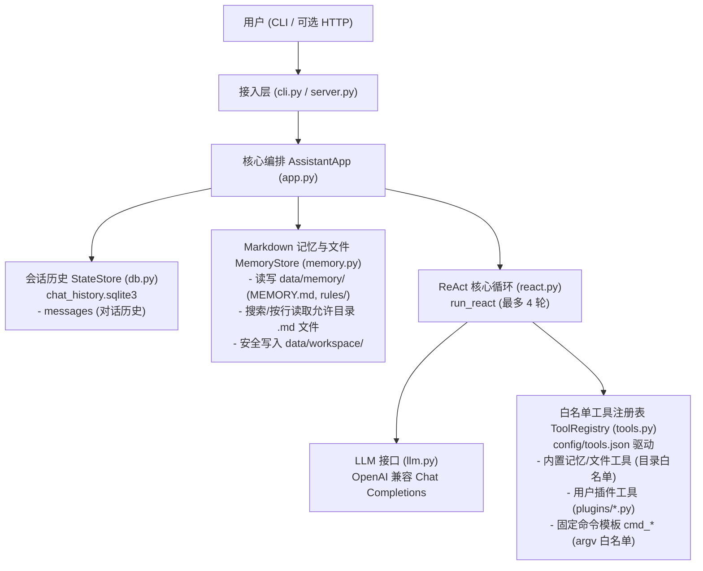

# My Helper — 最小 MVP 设计文档

## 1. 核心目标

本项目是一个从零搭建的**纯 Python 最小个人 AI Agent**（生产零第三方依赖），核心设计原则：

1. **无编译、无后台索引同步**：
   - 不做后台摘要编译、不做向量数据库同步，也不设后台 `worker` 进程。
2. **索引式纯文本 Markdown 记忆（防膨胀、KV Cache 友好）**：
   - **静态规则 + 目录索引（常驻前缀、会话内冻结）**：`data/memory/rules/*.md`（行为规则）与 `data/memory/MEMORY.md`（限长记忆目录索引，最多读取前 100 行 / 4000 字符）只在会话启动时读入一次并冻结在 `system` 前缀，绝不把无限增长的流水账塞进 Prompt。
   - **事实备忘与主题文件（按需检索）**：`remember_fact` 统一追加到 `data/memory/facts.md`（只在首次创建时往 `MEMORY.md` 登记一行索引指针，后续追加永不改动 `MEMORY.md`）；需要回忆历史事实或主题细节时，由模型按需调 `search_markdown` / `read_markdown` 查阅 `data/memory/`。
   - **追加式多轮历史**：`AssistantApp` 以标准 `[system, user_1, assistant_1, ..., user_n]` 顺序追加消息，不改写前面轮次，最大化跨轮 KV Cache 命中率。
3. **无 MCP，纯原生白名单与插件机制**：
   - 所有工具由宿主机纯 Python 原生实现，并通过唯一的配置文件 `config/tools.json` 进行**三级白名单管控**（工具名称白名单、文件读写目录白名单、固定 `argv` 命令模板白名单）。
   - 核心只保留必要的 Markdown 记忆与文件读写内置工具；其余扩展工具直接写在 `plugins/*.py` 中用 `@tool(...)` 声明，在白名单中勾选即可热插拔。
   - 不设繁琐的二次确认弹窗：凡在白名单且满足目录/参数约束的工具直接执行，白名单外的一切操作直接拒绝。
4. **纯 Python 单服务架构**：
   - 仅依赖 Python 标准库，直接通过终端 CLI 交互运行（可选暴露轻量本地 HTTP API）。

---

## 2. 整体架构与目录结构

### 2.1 运行时架构



### 2.2 项目目录结构

```text
my-helper/
├── config/
│   └── tools.json                 # 工具白名单、插件路径、目录安全与固定命令配置
├── plugins/
│   └── custom_tools.py            # 用户可编辑工具插件（@tool 声明，按白名单插入）
├── evals/
│   ├── sample_cases.jsonl         # 公开脱敏评测案例集
│   └── sample_data/               # 公开评测样例 Markdown 文件
├── docs/
│   └── mvp-design.md              # 本设计文档
├── personal_assistant/
│   ├── __init__.py
│   ├── __main__.py                # 启动入口
│   ├── cli.py                     # 命令行入口：chat (终端交互)
│   ├── app.py                     # AssistantApp：装配、上下文与会话历史
│   ├── react.py                   # 极简 ReAct 核心循环（最多 4 轮原生工具调用）
│   ├── llm.py                     # OpenAI 兼容 Chat Completions 客户端（标准库 urllib）
│   ├── memory.py                  # 核心内置 Markdown 记忆与安全文件读写工具
│   ├── tools.py                   # Tool、@tool 装饰器与 ToolRegistry 白名单注册表
│   ├── plugins.py                 # 动态加载 plugins/*.py 插件工具
│   ├── commands.py                # 固定 argv 命令模板加载与 ToolsConfig
│   ├── db.py                      # SQLite 连接与极简表结构（messages）
│   └── eval/                      # 离线检索评测与端到端 Agent 评测包
├── tests/                         # 面向 MVP 核心闭环的确定性单元测试
├── .env.example
├── .gitignore
├── pyproject.toml
└── README.md
```

### 2.3 数据目录结构（`data/`，不提交 Git）

```text
data/
├── memory/
│   ├── MEMORY.md                  # 记忆目录索引（限长前 100 行，会话内冻结，不存流水账）
│   ├── facts.md                   # remember_fact 追加的长期事实（不注入 Prompt，按需检索）
│   ├── rules/                     # 行为规则（每条一个 .md 文件，可读可直接手改）
│   └── audit.jsonl                # 记忆与文件写入审计日志
├── workspace/                     # write_file 唯一允许写入的工作目录（覆盖时自动备份至 .backups/）
└── state/
    └── chat_history.sqlite3       # 短期对话历史表 messages
```

---

## 3. 核心模块详细设计

### 3.1 记忆与文件工具模块（`personal_assistant/memory.py`）

不建数据库索引、不跑后台编译，所有读取直接面向文件系统中的 `.md` / `.txt` 文本文件：

1. **常驻前缀读取（仅会话首次加载并冻结）**：
   - `read_memory_index(max_lines=100, max_chars=4000) -> str`：只读取 `data/memory/MEMORY.md` 顶部目录索引；超长时截断尾部并提示按需调用 `read_markdown` 查阅全文。
   - `read_rules_summary(limit=30) -> str`：按文件名倒序读取 `data/memory/rules/*.md`，提取每条规则的 `- Statement:`（或首行标题），拼成列表。

2. **按需 Markdown 浏览与检索（供白名单工具调用）**：
   - **安全路径解析 `resolve_path(rel_path: str, *, write: bool = False) -> Path`**：
     - 拒绝绝对路径、拒绝 `..`、拒绝包含 `reject_segments`（如 `.env`, `.git`, `state`, `.ssh`, `uploads`）的任何路径段、检查 `resolve()` 后的真实路径属于配置的 `read_roots` 或 `write_root`。
   - **列文件 `list_files(root: str = "data/memory", pattern: str = "*.md") -> str`**：
     - 在允许的读取根目录内按 `glob`/`rglob` 匹配文件路径，返回相对路径列表（上限 `max_results=100`）。
   - **搜内容 `search_markdown(query: str, root: str = "data/memory") -> str`**：
     - 将 `query` 拆分为中英文词项，扫描目标目录下的 `.md` / `.txt` 文件并按文件名、标题、正文命中打分，返回前 `limit=10` 处最佳命中片段。
   - **读原文 `read_markdown(path: str, start_line: int = 1, end_line: int = 120) -> str`**：
     - 读取指定行号范围（单次上限 `max_lines=400`、`max_read_bytes=65536`），输出带行号的原文及总行数提示。

3. **记忆与规则写入**：
   - `remember_user_statement(user_text: str, message_id: int | None) -> str`：按时间戳与消息编号幂等追加到 `data/memory/facts.md`，仅在首次创建时往 `MEMORY.md` 登记一行索引指针，并写入 `data/memory/audit.jsonl`。
   - `save_rule(statement: str, source: str) -> Path`：写入 `data/memory/rules/<timestamp>-<slug>.md` 并记录 `audit.jsonl`。
   - `write_workspace_file(path: str, content: str, mode: str) -> str`：仅限写入 `data/workspace/`，`overwrite` 覆盖前自动备份到 `.backups/`。

---

### 3.2 白名单工具与插件系统（`tools.py` / `plugins.py` / `commands.py` / `config/tools.json`）

#### 配置文件 `config/tools.json` 格式

```json
{
  "enabled_tools": [
    "list_files",
    "search_markdown",
    "read_markdown",
    "write_file",
    "remember_fact",
    "save_rule",
    "get_current_time"
  ],
  "plugins": ["plugins"],
  "files": {
    "read_roots": ["data/memory", "data/workspace", "docs"],
    "write_root": "data/workspace",
    "max_read_bytes": 65536,
    "max_write_bytes": 65536,
    "max_lines": 400,
    "max_results": 100,
    "reject_segments": [".env", ".git", "state", ".ssh", "uploads"]
  },
  "commands": [
    {
      "name": "git_status",
      "description": "查看项目仓库的未提交改动。",
      "enabled": true,
      "argv": ["git", "status", "--short"],
      "cwd": ".",
      "timeout": 10,
      "max_output_bytes": 8192
    },
    {
      "name": "disk_usage",
      "description": "查看磁盘空间占用。",
      "enabled": true,
      "argv": ["df", "-h"],
      "cwd": ".",
      "timeout": 10,
      "max_output_bytes": 8192
    }
  ]
}
```

#### `ToolRegistry` 纯白名单执行机制

1. **严格白名单过滤**：仅注册 `enabled_tools` 中列出的内置/插件工具及 `commands` 中 `enabled: true` 的命令工具；未在白名单中的工具既不发送给 LLM，也拒绝执行。
2. **参数校验**：检查 JSON 对象、必填字段、类型（含 `enum` 与正则 `pattern`）。
3. **直接执行与错误回传**：校验通过直接运行并在固定字节上限内返回结果；任何参数错误、越界或执行异常直接转成 `"错误：..."` 观察字符串回传模型，不崩溃。

---

### 3.3 对话循环与核心编排（`react.py` + `app.py`）

- **`run_react()`**：标准 3 段式循环（Reason -> Act & Observe -> 达上限后 `tools=None` 总结），默认最多 `MAX_TOOL_ROUNDS = 4` 轮。
- **`AssistantApp`**：统一串联对话历史、系统提示词拼装、工具白名单装配与 `run_react()` 执行。

---

### 3.4 状态存储（`personal_assistant/db.py`）

只保留一个 SQLite 数据库文件 `data/state/chat_history.sqlite3`，包含一张 `messages` 表记录短期多轮对话历史：

```sql
CREATE TABLE IF NOT EXISTS messages (
    id INTEGER PRIMARY KEY AUTOINCREMENT,
    chat_id TEXT NOT NULL,
    role TEXT NOT NULL,
    content TEXT NOT NULL,
    created_at TEXT NOT NULL
);
```

---

### 3.5 本地接入层（`cli.py` / 可选 `server.py`）

1. **终端交互（`personal_assistant/cli.py`）**：
   - `uv run python -m personal_assistant chat`：直接进入终端 REPL 与助手对话，支持 `/status`、`/memory`、`/search <关键词>` 离线快捷命令。
2. **轻量本地 HTTP API（可选 `personal_assistant/server.py`）**：
   - `uv run python -m personal_assistant serve [--host 127.0.0.1] [--port 8765]`：按需暴露 `/health`、`/status`、`/search`、`/chat` 等 JSON 接口。

---

## 4. 开发步骤

1. **Step 1 — 最小 ReAct 核心循环（`llm.py`, `tools.py`, `react.py`, `cli.py`）**
2. **Step 2 — 白名单工具、插件与命令执行器（`config/tools.json`, `tools.py`, `plugins.py`, `commands.py`, `plugins/`）**
3. **Step 3 — 纯 Markdown 记忆与安全文件工具（`memory.py`）**
4. **Eval — 离线检索与端到端 Agent 评测包（`personal_assistant/eval/`）**
5. **Step 4 — SQLite 会话历史与核心编排（`db.py`, `app.py`）**
6. **Step 5 — 可选轻量本地 HTTP 服务（`server.py`）**
