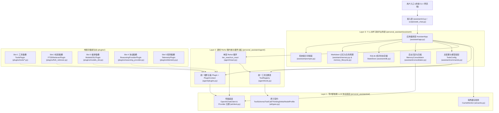

# My Helper v2 — 架构与系统设计文档

## 1. 设计目标与架构定调

本项目是从零搭建的**零第三方运行依赖个人与学习 AI Agent**：以借鉴 Pi 洋葱模型的三层微内核为底座，向上叠加 KV Cache 优先的纯 Markdown 长期记忆、纵深安全边界与学习助手特色工作流。

核心工程原则：

1. **零第三方运行依赖**：
   - 生产代码仅使用 Python 3.12+ 标准库（`urllib`、`sqlite3`、`threading`、`http.server`、`shlex`、`ipaddress` 等）；`pytest` 仅作为开发测试依赖。
2. **三层单向依赖漏斗（`ai ← agent ← assistant`）**：
   - `personal_assistant/ai/`（Layer 1）零内部依赖；
   - `personal_assistant/agent/`（Layer 2）仅依赖 `ai/`，不含个人助手或学习助手业务假设；
   - `personal_assistant/assistant/`（Layer 3）向上组装个人助手与学习工作流；
   - 顶层评测包 `evals/` 与 `plugins/`、`tests/` 平级，绝不被产品包反向导入。由 [../tests/test_architecture.py](../tests/test_architecture.py) 通过 AST 依赖图与子进程 `sys.modules` 断层隔离测试强守卫。
3. **极简单层 ReAct 微内核**：
   - 不照搬 `coding-agent` 的双层插队队列（`steering` / `followUp`），将 [../personal_assistant/agent/react.py](../personal_assistant/agent/react.py) 保持为 30 余行单层 `while True` 循环（`iter_react()` / `run_react()`），移除 `MAX_TOOL_ROUNDS` 人为截断与 `tools=None` 强行总结，仅以强类型 `ToolCall` 列表为空作为唯一自然终止条件，并提供 `transform_context -> convert_to_llm` 两阶段纯函数边界钩子。
4. **外层 `Plugin(ABC)` 主板 + 内层五大子协议**：
   - 所有扩展能力（工具、检索后端、DSL 编译器、推理协议、运行遥测）均通过外层 `Plugin(ABC)` 在启动期执行一次 `initialize()` 注册进 `PluginContext` 五大强类型插槽，核心微内核与业务编排只依赖子协议契约。
5. **KV Cache 优先的纯 Markdown 记忆与成对原子会话存储**：
   - `MEMORY.md` 仅作限长索引并在会话内冻结于系统前缀；`facts.md` 与主题 `.md` 文件按需检索；`StateStore.append_turn` 单事务成对原子落库，只追不删。
6. **纵深防御安全隔离**：
   - 文件路径白名单与软链拦截、Shell 参数级防两步 RCE 与选项走私、Web 防 DNS 重绑定与私网 SSRF、本地 HTTP 服务防 CSRF、密钥 `0600` 原子落盘与全链路脱敏。

---

## 2. 洋葱分层模型与目录结构

### 2.1 三层单向依赖漏斗与插件主板



### 2.2 仓库目录结构

```text
my_helper_v2/
├── config/
│   ├── tools.json                     # 工具白名单、插件入口与 retrieval/telemetry/web/shell/files/commands 段配置
│   └── models.example.dsl             # 极简模型配置 DSL 示例（支持 use / add / consolidator）
├── plugins/
│   ├── tools/
│   │   ├── __init__.py
│   │   ├── plugin.py                  # ToolsPlugin(Plugin)：统一扫描本目录 @tool 模块
│   │   ├── custom_tools.py            # 可自由编辑工具（get_current_time / add_numbers）
│   │   ├── shell_tools.py             # 受控白名单 Shell 插件（run_command）
│   │   ├── web_tools.py               # 联网搜索与防 SSRF 抓网页（web_search / fetch_webpage）
│   │   ├── history_tools.py           # 只读增量 FTS5 跨会话历史检索（search_chat_history）
│   │   └── study_tools.py             # 学习助手卡片与间隔重复调度（save_study_card / list_due_reviews，PR #64）
│   ├── fts5_retriever.py              # SQLite FTS5 + BM25 双语检索插件（RetrieverProtocol）
│   ├── models_dsl.py                  # 极简模型 DSL 编译器插件（ConfigCompilerProtocol）
│   ├── reasoning_provider.py          # 推理模型协议插件（LLMProviderProtocol：openai_reasoning）
│   └── telemetry.py                   # 运行期耗时拆解与后台任务观测插件（ObserverProtocol）
├── personal_assistant/                # 纯净三层产品包（绝不依赖 evals/）
│   ├── __init__.py
│   ├── __main__.py
│   ├── ai/                            # Layer 1：types.py / client.py / cache.py
│   ├── agent/                         # Layer 2：tools.py / react.py / plugins.py
│   └── assistant/                     # Layer 3：common.py / prompts.py / memory.py / memory_lifecycle.py /
│                                      #          db.py / consolidator.py / commands.py / app.py / cli.py
├── scripts/
│   ├── demo.py                        # 离线演示与单句实测脚本
│   ├── web_chat.py                    # 零依赖本地 HTTP/SSE 服务（ThreadingHTTPServer）
│   └── web_ui.html                    # 纯 HTML/JS 流式推导与交互页面
├── evals/                             # 顶层统一评测包（search_eval / agent_eval / memory_eval / public_benchmarks）
├── tests/                             # 确定性单元测试与架构守卫（含 test_architecture.py 与 PR #64 test_study_plugin.py）
├── docs/
│   ├── mvp-design.md                  # 本架构设计文档
│   └── dev-log.md                     # 工程演进、排坑根因与 Benchmark 总账
├── AGENTS.md
└── pyproject.toml
```

### 2.3 运行时数据目录结构（`data/`，不提交 Git）

```text
data/
├── memory/
│   ├── MEMORY.md                      # 限长记忆目录索引（前 100 行 / 4000 字符，会话内冻结）
│   ├── facts.md                       # remember_fact 追加的长期事实（轮内 turn# 暂存 -> 成功后绑定 msg#）
│   ├── <topic>.md                     # 后台沉淀按主题组织的长期记忆（支持 add/merge/replace/remove）
│   ├── rules/                         # 行为规则（每条一个 .md，摘要注入系统前缀）
│   ├── archive/                       # 过期日程与 replace/remove 软退休替代链（YYYY-MM.md，默认隔离检索）
│   └── audit.jsonl                    # 记忆与文件写入审计日志
├── workspace/                         # write_file 唯一允许写入的工作目录
│   ├── .backups/                      # overwrite 模式覆盖前的自动时间戳备份
│   ├── tool_outputs/                  # TOAST 超长工具输出按行落盘目录（上限 1 MB，保留 20 个 / 24h TTL）
│   └── study/                         # study_tools.py 落盘的结构化 Markdown 知识卡片（<slug>.md）
└── state/
    └── chat_history.sqlite3           # 短期对话历史（messages）与滚动压缩状态（session_compactions）
```

---

## 3. 分层与核心模块详细设计

### 3.1 Layer 1：LLM 协议与缓存观测底座（`personal_assistant/ai/`）

1. **原子契约（[../personal_assistant/ai/types.py](../personal_assistant/ai/types.py)）**：
   - `ToolSchema`：最底层工具签名（`name`、`description`、`parameters`、`param_enums`），仅负责导出 OpenAI Function Calling JSON Schema，不含本地执行器。
   - `ToolCall` & `extract_tool_calls()`：统一将 OpenAI wire 字典或扁平工具调用解析为强类型 `ToolCall(id, name, arguments)`，空参数兜底 `"{}"`。
   - 流式事件：`TextDelta(text)`、`ThinkingDelta(text)`、`StreamDone(message, usage, ttft_ms, latency_ms)`、`TokenUsage(prompt_tokens, cached_tokens, completion_tokens)`。
   - 模型档案：`ModelProfile`（支持 `provider`、`base_url`、`model`、`api_key`、`key_env`、`temperature`）与 `ModelsConfig`，统一提供 `redacted_dict()` 脱敏导出。
2. **传输底座与 Provider 分发（[../personal_assistant/ai/client.py](../personal_assistant/ai/client.py)）**：
   - `LLMClient` 定义 `respond()` 与默认回退 `stream()`；`OpenAIChatClient(LLMClient)` 提供四个正交受保护钩子：`_prepare_messages`、`_extra_payload`、`_thinking_delta_fields` 与 `_normalize_response_message`，同时服务标准 `OpenAICompatibleLLM` 与外围推理模型插件。
   - `_post_with_retry` 使用标准库 `urllib` 对 `IncompleteRead`、`SSLError`、`URLError`、`TimeoutError`、`ConnectionError`、HTTP `429`/`5xx` 做最多 2 次指数退避重试（跳过确定性 `4xx`）；流式请求在建连前重试并对不支持 `stream_options.include_usage` 的 HTTP 400 自动降级一次；`extract_usage()` 统一兼容 `prompt_cache_hit_tokens`、`prompt_tokens_details.cached_tokens` 与 `cache_read_input_tokens`。
   - `register_provider()` / `from_env()` / `from_model_profile()` 支持插件注册非标准对话协议而不触碰核心循环。
3. **有界 KV 缓存观测（[../personal_assistant/ai/cache.py](../personal_assistant/ai/cache.py)）**：
   - `CacheMonitor(max_records=2000, max_sessions=256)` 使用 `threading.Lock` 维护有界 `deque`、MRU 会话序列化前缀表、单调递增游标 `snapshot_index()` 与 $O(1)$ 内存全生命周期累计账本（`summary(since=0)` 全局精确，`summary(since=idx)` 按游标切片单轮统计）。
   - `TrackingLLMClient` 通过 `threading.local()` 隔离并发场景的 `last_usage`，在 `respond()` 与 `stream()` 完成时无侵入采集本地前缀复用率与服务端缓存命中率。

---

### 3.2 Layer 2：通用 ReAct 内核与统一插件主板（`personal_assistant/agent/`）

1. **工具类型递进扩展与统一注册表（[../personal_assistant/agent/tools.py](../personal_assistant/agent/tools.py)）**：
   - `Tool(ToolSchema)` 继承底层签名并新增 `handler` 与 `run(**values)`；
   - `build_tool()` 统一将普通函数或子类适配为 `Tool` 实例，经 `inspect.signature()` 自动按参数名绑定运行时上下文（`project_root`、`data_root`、`config_path`、`offload_dir` 等），并挂载 `ToolMetadata(risk, always_on)` 与 `ToolDocument(source_type, source_name)`；
   - `ToolsetProvider` 统一抽象三大工具来源（内置 `MemoryToolsetProvider`、插件 `PluginManager`、固定命令 `CommandToolsetProvider`）；
   - `ToolRegistry` 维护 `_all_tools` 与激活视图 `_tools`（受白名单 `allowed_names` 或 `always_on` 控制），校验 JSON 对象、必填键、非 bool 数值自动转字符串与枚举范围，任何参数或运行异常均转为 `"错误：..."` 观察回传模型自愈。
2. **纯粹单层 ReAct 循环与两阶段消息边界（[../personal_assistant/agent/react.py](../personal_assistant/agent/react.py)）**：
   - `iter_react()` / `run_react()` 维持极简 `while True` 循环：进入循环前固定 `tool_defs`，每轮先经可选边界管道 `_prepare_llm_messages(messages, transform_context, convert_to_llm)`（未传钩子时零拷贝透传；传钩子时对消息字典浅拷贝以防污染外部会话），调用 `llm.stream()` 并透传 `TextDelta` / `ThinkingDelta` / `StreamDone`；
   - 仅当 `extract_tool_calls(assistant_msg)` 为空时记录最终回复并产出 `TurnEnd`，否则在执行每个强类型 `ToolCall` 前发出 `ToolStart(tool, arguments, call_id)`，完成后发出 `ToolStep(tool, arguments, observation, duration_ms, call_id)` 并追加 `role="tool"` 观察消息；
   - `_normalize_stored_assistant` 保留 `assistant_msg` 上的协议扩展字段（如轮内工具调用的 `reasoning_content`），同时统一清理或标准化 `tool_calls`。
3. **统一插件主板与单次初始化生命周期（[../personal_assistant/agent/plugins.py](../personal_assistant/agent/plugins.py)）**：
   - 外层主板 `Plugin(ABC)` 通过 `__init_subclass__` 自动登记到模块 `__plugin_classes__`，统一持有 `self.context: PluginContext`，并提供 5 个强类型插槽：
     - 插槽 1：`register_tool` → `Tool`（含 `@tool` 自动包装 `_AutoScriptPlugin`）
     - 插槽 2：`register_retriever` → `RetrieverProtocol`（`search_hits(...)`）
     - 插槽 3：`register_compiler` → `ConfigCompilerProtocol`（`compile(...)` / `presets()` / `render(...)`）
     - 插槽 4：`register_provider` → `LLMProviderProtocol`（`build(env)`）
     - 插槽 5：`register_observer` → `ObserverProtocol`（`on_event(session_key, event)` / `snapshot(session_key=...)`）
   - `PluginManager.from_entries()` 按文件指纹 `(st_mtime_ns, st_size, st_ino)` 缓存动态导入模块并**仅执行一次** `Plugin.initialize()`，记录原始 `_PluginToolSpec`；执行期调用 `PluginManager.build_tools(context)` 仅按当前请求上下文重绑函数型工具签名参数并克隆自定义 `Tool` 子类（`_clone_custom_tool`），彻底消除每轮重复初始化开销与模块状态清空竞态。

---

### 3.3 Layer 3：个人与学习助手业务层（`personal_assistant/assistant/`）

1. **无内部依赖基础原语与 TOAST 卸载（[../personal_assistant/assistant/common.py](../personal_assistant/assistant/common.py)）**：
   - 提供 `format_date_with_weekday`（注入如 `2026-11-26（星期四，北京时间）` 消除相对日期推算误差）、`load_dotenv`、`truncate_utf8` 与 `truncate_or_offload()`；
   - `truncate_or_offload()` 对超预算的网页/命令输出做单行软折行与 1 MB 封顶落盘至 `data/workspace/tool_outputs/`，按 `head` 或 `head_tail` 模式返回带精确行号与 `read_markdown` / `search_markdown` 续读指引的预览，并懒清理保留最新 20 个 / 24 小时 TTL。
2. **Markdown 记忆、生命周期与 6 个内置工具（`memory.py` + `memory_lifecycle.py`）**：
   - `MemoryStore` 使用可重入写锁 `_write_lock` 保护所有磁盘写盘与 `audit.jsonl` 审计日志；`read_memory_index(max_lines=100, max_chars=4000)` 与 `read_rules_summary(limit=30)` 供会话冻结前缀使用；
   - `list_files` 与 `iter_searchable_files`（基于 `os.scandir` 高效遍历）默认跳过 `data/memory/archive/`，仅当显式指定 `root="data/memory/archive"` 时开放查阅；
   - `remember_user_statement` 支持流内 `turn_tag`（`(turn#<tag>)`）暂存与回合末 `finalize_turn_fact(turn_tag, message_id=...)` 升级绑定 `(msg#<id>)` 或中断回滚；
   - `apply_topic_operations` 实现四元操作码：
     - `add`：新增独立事实（幂等去重，跳过已过期条目）；
     - `merge`：按子句边界检测幂等无损拼接互补维度（保留原时间戳与 `(until: ...)`）；
     - `replace` / `remove`：原地更新或删除活跃条目，同时将退场旧值连同 `-> superseded_by: ...` 替代链软退休至 `data/memory/archive/YYYY-MM.md`，并在 `MEMORY.md` 幂等登记归档入口指针；
   - `archive_expired_topics` 每日首次对话自动迁移过期 `(until: YYYY-MM-DD)` 条目；`prune_raw_facts_for_batch` 清理 `facts.md` 中已被规范化吸收的 `(msg#...)` 幽灵裸行。
   - `MemoryToolsetProvider` 导出 6 个 `BuiltinTool(Tool)`：`list_files`、`search_markdown`、`read_markdown`、`write_file`、`remember_fact`、`save_rule`。
3. **成对原子 SQLite 状态存储（[../personal_assistant/assistant/db.py](../personal_assistant/assistant/db.py)）**：
   - 独立零内部依赖模块，打开 `data/state/chat_history.sqlite3` 并启用 `PRAGMA journal_mode=WAL` 与 `RLock`；表结构包含 `messages`（含索引 `idx_messages_chat_id`）与 `session_compactions`：

```sql
CREATE TABLE IF NOT EXISTS messages (
    id INTEGER PRIMARY KEY AUTOINCREMENT,
    chat_id TEXT NOT NULL,
    role TEXT NOT NULL,
    content TEXT NOT NULL,
    created_at TEXT NOT NULL
);
CREATE INDEX IF NOT EXISTS idx_messages_chat_id ON messages (chat_id, id);

CREATE TABLE IF NOT EXISTS session_compactions (
    chat_id TEXT PRIMARY KEY,
    summary TEXT NOT NULL,
    compacted_until_id INTEGER NOT NULL DEFAULT 0,
    updated_at TEXT NOT NULL
);
```

   - 核心不变量：
     - **成对原子写入**：`StateStore.append_turn(chat_id, user_content, assistant_content)` 在同一数据库事务中原子插入问答双行（异常时整轮回滚），保证 `messages` 100% 只追不删且不残留中断产生的孤儿 `user` 消息；
     - **只读快照边界与单调压缩游标**：`max_message_id()` 为同轮跨会话检索锁定上界；`save_compaction()` 单调推进 `compacted_until_id`，`active_messages()` 仅读取 `id > compacted_until_id` 的活跃消息，旧原文完整保留供冷检索回溯。
4. **后台记忆沉淀与双模型分槽（`consolidator.py` + `commands.py` + `app.py`）**：
   - `ConsolidationPolicy` 默认当活跃消息达到 `16` 条或 `8000` 字符时（且待压缩批至少 `4` 条，保留最近 `6` 条），由 `BackgroundConsolidator` 拉起同 `chat_id` 互斥的 daemon `threading.Thread` 执行 `MemoryConsolidator.consolidate_once()`，并用 `json.JSONDecoder().raw_decode()` 稳健提取结构化 JSON；完成后通过 `on_event` 单点发出 `TaskEvent(kind="consolidation", ...)` 并回调刷新会话冻结提示词。
   - `AssistantApp` 支持独立注入 `consolidator_llm`（优先读取配置中顶层 `consolidator <模型名>`，未配置时回退共享主对话 `llm`），实现前台 `deepseek-reasoner` 深度推导 + 后台 `deepseek-chat` 低成本整理笔记的无缝分槽；同时通过有界会话级互斥锁 `_chat_turn_lock` 保障同 `chat_id` 串行执行、`stream_chat()` 单一主流程（`chat()` 经 `contextlib.closing` 消费）与 `_convert_context_to_llm`（接入 Layer 2 `convert_to_llm` 钩子将 `compaction_summary` 转为标准 `user/assistant` 承接对并安全合并历史异常连续同角色消息）。

---

### 3.4 外围插件与个人学习助手叠加层（`plugins/` 与 `scripts/`）

- **检索插件（[../plugins/fts5_retriever.py](../plugins/fts5_retriever.py)）**：SQLite FTS5 + BM25，英文不规则词还原 + 中文虚词切分 + Bigram，大语料（`>= 10` 块）启用 `min_bm25_score` 过滤（规避小语料 SQLite 原生 IDF=0 漏召回），窗口去重 `<= 2` 与高置信放行（命中 `>= 3` 词且 BM25 `>= 10`）。
- **配置 DSL 编译插件（[../plugins/models_dsl.py](../plugins/models_dsl.py)）**：手写词法与递归下降解析器，内置 8 大厂商预设（含 `deepseek_reasoner`），支持一行 `use`/`add`、块状 `model { ... }` 与顶层 `consolidator <模型名>` 双模型分槽指令。
- **推理协议插件（[../plugins/reasoning_provider.py](../plugins/reasoning_provider.py)）**：`OpenAIReasoningLLM(OpenAIChatClient)` 声明 `_thinking_delta_fields() -> ("reasoning_content",)`，在 `_prepare_messages` 中仅剥离最后一条 `user` 之前的历史思维链，保留当前轮多步工具调用的 `reasoning_content`。
- **遥测插件（[../plugins/telemetry.py](../plugins/telemetry.py)）**：`TelemetryObserver` 维护 `deque(maxlen=window_size)` 与有界 MRU 会话账本，拆解 `total_ms` / `ttft_ms` / `llm_ms` / `tool_ms` / `overhead_ms` 与后台沉淀统计，接入 `/status` 与前端展示。
- **扩展工具（`plugins/tools/`）**：
  - `custom_tools.py`：`get_current_time`、`add_numbers`；
  - `shell_tools.py`：`run_command`（只读/受控命令沙箱 + Head+Tail TOAST）；
  - `web_tools.py`：`web_search`（Tavily / Brave / DuckDuckGo HTML / Bing RSS）与 `fetch_webpage`（防 SSRF + 2 MB 下载上限 + Head TOAST）；
  - `history_tools.py`：`search_chat_history`（只读 `?mode=ro` 增量内存 FTS5 跨会话原文检索，`id < before_msg_id` 隔离当前轮）；
  - `study_tools.py` *(同波次 PR `#64`)*：零微内核侵入学习助手插件，提供 `save_study_card`（在 `data/workspace/study/<slug>.md` 创建或幂等更新结构化 Markdown 知识卡片并推进 Leitner/SM-2 精简间隔复习计划）与 `list_due_reviews`（查询到期复习队列与全局学习进度）。
- **本地流式 Web/SSE 服务（[../scripts/web_chat.py](../scripts/web_chat.py) & [../scripts/web_ui.html](../scripts/web_ui.html)）**：
  - 标准库 `ThreadingHTTPServer` 暴露 `GET /`、`/api/status`、`/api/memory`、`/api/models`、`/api/history` 及 `POST /api/chat`、`/api/chat/stream`（SSE `Connection: close`）、`/api/refresh`、`/api/models/setup`；
  - 前端使用纯原生 JS `ReadableStream` 消费 SSE 帧（含 `thinking_delta` 可折叠思维链教学面板、`tool_start` 慢工具状态提示、`tool_step`、`text_delta`、`done`）、XSS 安全 Markdown 渲染器及模型设置弹窗。

---

## 4. 纵深防御安全架构

1. **文件与敏感段双沙箱**：
   - `FilesPolicy` 强制检验相对路径、`..`、符号链接逐段校验，所有读取限定在 `read_roots`，写入仅限 `data/workspace/`；`reject_segments` 屏蔽 `.env`、`.git`、`.ssh`、`state`、`uploads`、`models.dsl`、`models.json`。
2. **Shell 命令沙箱（[../plugins/tools/shell_tools.py](../plugins/tools/shell_tools.py)）**：
   - 仅允许白名单可执行名且以 `shell=False`、最小脱敏环境变量执行；
   - 拦截管道、分号、重定向、`$()` 与反引号；
   - 针对高危工具实施参数级红线：`pytest` 除 `--version`/`-V` 外必须落入 `tests/` 并注入 `--ignore=data` 封堵两步 RCE；`git` 仅放行只读子命令且禁止全局选项走私与 pathspec 魔法；`grep`/`rg` 全量扫描后再定位路径并将排除项置顶于 `--` 之前；对全部敏感段及 `.env.*`（仅精确放行 `.env.example`）执行大小写不敏感匹配以兼容 macOS APFS。
3. **Web 抓包与本地服务防线**：
   - `fetch_webpage` 通过 `validate_public_url` 与 `_SafeRedirectHandler` 在初始及每跳重定向前拦截非 `http/https`、`.local`/`.internal`、回环/私网/云元数据 IP（同时为非字面 IP 域名解析放行 macOS TUN `198.18.0.0/15` Fake-IP）；
   - `web_chat.py` 全路由校验 `Host` 白名单（支持 IPv6 RFC 5952 规范化），敏感 `GET /api/*` 与全部 `POST` 校验同源 `Origin` 与 `Sec-Fetch-Site in {"same-origin", "none"}`，强制单一非逗号折叠 `Content-Type: application/json`（`415` 拒绝 Simple Request CSRF）并附加 `X-Content-Type-Options: nosniff`。
4. **密钥隔离与脱敏**：
   - `config/models.dsl` 与 `config/models.json` 由 `.gitignore` 忽略、经 `tempfile` + `0o600` 原子写入，并在 `ModelsConfig.redacted_dict()` 全链路脱敏。

---

## 5. 可复现评测架构（`evals/`）

1. **双向隔离与无污染设计**：
   - `personal_assistant/` 严禁导入 `evals/`；`evals/` 严禁导入 `assistant/cli.py`；所有读写评测均拷贝至 `tempfile.TemporaryDirectory` 执行，绝不修改仓库 `data/`；报告写出路径经 `safe_write_report` 禁止落入 `--data-dir`。
2. **四层评测模式（`uv run python -m evals --mode ...`）**：
   - `search`（[../evals/search_eval.py](../evals/search_eval.py)）：零 Token 对比 `linear` 与 `fts5_bm25` 等检索插件（输出 `pass_rate`、`mean_source_recall`、`mean_mrr`、`mean_quote_coverage`、`negative_clean_rate`、`mean_latency_ms`）；
   - `agent`（[../evals/agent_eval.py](../evals/agent_eval.py)）：单轮冻结前缀实跑 ReAct 循环，统计工具链命中与 KV 缓存；
   - `memory`（[../evals/memory_eval.py](../evals/memory_eval.py)）：驱动 `AssistantApp` 跑完多轮对话、后台沉淀与隔离问答，支持 `shared_setup` / `shared_group`（如 LoCoMo 长会话只沉淀一次后隔离复用）、`--workers` 保序并发与独立 `--judge-model` 同口径评分（Judge 与被测 Agent 的 KV Cache 统计严格隔离）；
   - `download`（[../evals/public_benchmarks.py](../evals/public_benchmarks.py)）：零依赖拉取并分层抽样转换 LongMemEval（ICLR 2025）与 LoCoMo（ACL 2024）至 `evals/public/`。

---

## 6. 里程碑演进总览

1. **Step 1 ~ Step 4 核心闭环**：单层 ReAct 循环、白名单 `ToolRegistry` 与 `CommandSpec`、纯 Markdown 记忆与 `StateStore` 持久化。
2. **Pi 三层重构与五大主板插槽**：落地 `ai ← agent ← assistant` 漏斗、AST 架构守卫、外层 `Plugin(ABC)` 与 5 个内层子协议。
3. **记忆生命周期与运行期加固**：实现 `add`/`merge`/`replace`/`remove` 软退休、`search_chat_history` 只读跨会话 FTS5、TOAST 大输出卸载、有界 `CacheMonitor`、单次插件初始化与 `append_turn` 成对原子落库。
4. **纵深安全与四层基准体系**：封堵 Shell 两步 RCE / Web SSRF / 本地 HTTP CSRF，打通 40 题/16 场景及 LongMemEval（`deepseek-reasoner` 97.14%）与 LoCoMo（`deepseek-chat` 84.00%）复现闭环。
5. **个人学习助手叠加层**：落地流式推导思维链折叠面板（`thinking_delta` + `tool_start`）、前后台双模型分槽（`consolidator`）与纯 Markdown 间隔重复知识卡片（`study_tools.py`）。
