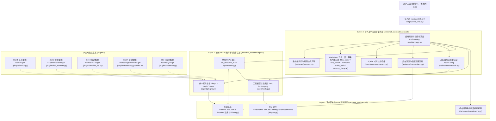

# My Helper v2 — 架构与系统设计文档

## 1. 设计目标与核心约束

本项目是一个纯 Python 标准库实现的个人与学习 AI Agent。系统以借鉴 Pi 洋葱模型的三层微内核为底座，在外层按正交协议叠加纯 Markdown 长期记忆、纵深安全沙箱与学习辅导工作流。

核心工程约束：

1. **零第三方运行依赖**：
   - 生产代码仅使用 Python 3.12+ 标准库（`urllib`、`http.client`、`sqlite3`、`threading`、`http.server`、`shlex`、`ipaddress`、`unicodedata` 等）；`pytest` 仅作为开发测试依赖。
2. **三层单向依赖漏斗（`ai ← agent ← assistant`）**：
   - `personal_assistant/ai/`（Layer 1）：零内部依赖的 LLM 传输协议、`ModelProfile` 直通工厂（`from_model_profile`）、通用命名角色表 `ModelsConfig.roles`、流式事件与有界 KV Cache 观测；
   - `personal_assistant/agent/`（Layer 2）：仅依赖 `ai/` 的通用 ReAct 循环、纯值对象工具递进扩展（`ToolSchema → Tool` + `bind_tool_context`）与零业务字段 `PluginContext` 统一插件主板，不含业务路径、具体插件名或配置段硬编码；
   - `personal_assistant/assistant/`（Layer 3）：个人与学习助手业务编排（零内部依赖底座 `common.py`/`text_search.py`/`files_policy.py`、Markdown 记忆与内置 `LinearRetriever` 兜底、SQLite 会话存储、外层回合预算、后台压缩与 CLI/Web 接入）；
   - 顶层评测包 `evals/` 与 `plugins/`、`tests/` 平级，产品包绝不反向导入 `evals/`，由 [../tests/test_architecture.py](../tests/test_architecture.py) 通过 AST 依赖图、业务字面量扫描、子进程 `sys.modules` 断层隔离测试与四棵目录树（`personal_assistant/`、`plugins/`、`scripts/`、`evals/`）零 `# type: ignore` 硬守卫强制保障。
3. **极简单层 ReAct 内核 + 外层有界预算**：
   - 不引入面向多路并发抢占编码代理的双层插队队列（`steering` / `followUp`），将 [../personal_assistant/agent/react.py](../personal_assistant/agent/react.py) 保持为 30 余行单层 `while True` 循环（`iter_react()` / `run_react()`），仅以 `extract_tool_calls(assistant_msg)` 为空作为自然终止信号，并提供单步 `convert_to_llm` 纯函数边界钩子与执行期 `tool_context` 透传；
   - 生产环境的防死循环与成本上限由 Layer 3 `AssistantApp` 的 `_GuardedTurnLLM` 装饰器在外层实施，既保障运行期有界，又不侵入通用内核。
4. **外层 `Plugin(ABC)` 主板 + 内层五大子协议**：
   - 工具、检索后端、配置 DSL 编译器、推理模型协议与运行遥测统一继承 `Plugin(ABC)`，在装配期执行单次 `initialize()` 注册进零业务字段的 `PluginContext` 五大强类型插槽，并在 `AssistantApp.close()` 时执行 `terminate_all()` 回收资源。
5. **KV Cache 友好的 Markdown 记忆与成对原子会话存储**：
   - `MEMORY.md` 仅作限长索引并在会话内冻结于系统前缀；详细记忆按主题存为 Markdown 文件按需检索；`StateStore.append_turn` 在单事务内成对写入 `user` 与 `assistant`，`get_context_snapshot` 在单把锁内原子读取活跃历史与压缩快照。
6. **纵深防御安全隔离**：
   - 覆盖 APFS Unicode/Inode 文件边界、逐子命令只读 Shell 沙箱与进程组强杀、DNS Pinning 防重绑定 SSRF、间接提示词注入写规则拦截，以及本地 HTTP/SSE 服务的同源与响应头防护。

---

## 2. 洋葱分层模型与目录结构

### 2.1 三层单向依赖漏斗与插件主板



### 2.2 仓库目录结构

```text
my_helper_v2/
├── config/
│   ├── tools.json                     # 工具白名单、插件入口与 retrieval/telemetry/web/shell/files/commands 段配置
│   └── models.example.dsl             # 模型配置 DSL 示例（支持 use / add / default / consolidator）
├── plugins/
│   ├── tools/
│   │   ├── plugin.py                  # ToolsPlugin(Plugin)：统一扫描本命名空间目录 @tool 模块
│   │   ├── custom_tools.py            # 示例与时钟工具（get_current_time / add_numbers）
│   │   ├── shell_tools.py             # 受控白名单 Shell 插件（run_command）
│   │   ├── web_tools.py               # 联网搜索与直连 http.client+TLS/DNS Pinning 抓网页（web_search / fetch_webpage）
│   │   ├── history_tools.py           # 只读增量 FTS5 跨会话历史检索（search_chat_history）
│   │   └── study_tools.py             # 学习助手卡片与间隔重复调度（save_study_card / list_due_reviews）
│   ├── fts5_retriever.py              # SQLite FTS5 + BM25 双语检索插件（RetrieverProtocol）
│   ├── models_dsl.py                  # 模型配置 DSL 编译器插件（ConfigCompilerProtocol）
│   ├── reasoning_provider.py          # 推理模型协议插件（LLMProviderProtocol：openai_reasoning）
│   └── telemetry.py                   # 有界 MRU 会话耗时拆解与后台任务观测插件（ObserverProtocol）
├── personal_assistant/                # 纯净三层产品包（绝不反向依赖 evals/）
│   ├── __init__.py
│   ├── __main__.py
│   ├── ai/                            # Layer 1：types.py / client.py / cache.py
│   ├── agent/                         # Layer 2：tools.py / react.py / plugins.py
│   └── assistant/                     # Layer 3：common.py / text_search.py / files_policy.py / prompts.py /
│                                      #          memory.py / builtin_tools.py / memory_lifecycle.py /
│                                      #          db.py / consolidator.py / commands.py / app.py / cli.py
├── scripts/
│   ├── demo.py                        # 离线演示与单句实测脚本
│   ├── web_chat.py                    # 零依赖本地 HTTP/SSE 服务（ThreadingHTTPServer）
│   └── web_ui.html                    # 原生 HTML/JS 流式推导与交互页面
├── evals/                             # 顶层统一评测包（search_eval / agent_eval / memory_eval / public_benchmarks）
├── tests/                             # 确定性单测、宿主隔离 conftest.py 与架构/红队守卫
├── docs/
│   ├── mvp-design.md                  # 本架构设计文档
│   └── dev-log.md                     # 当前基线、关键工程权衡、排坑记录与演进日志
├── AGENTS.md
└── pyproject.toml
```

### 2.3 运行时数据目录结构（`data/`，不纳入版本控制）

```text
data/
├── memory/
│   ├── MEMORY.md                      # 限长记忆目录索引（前 100 行 / 4000 字符，会话内按自然日冻结）
│   ├── facts.md                       # remember_fact 追加的原始事实（流式轮内 turn# 暂存 -> 提交后升级 msg#）
│   ├── <topic>.md                     # 后台沉淀按主题组织的长期记忆（支持 add/merge/replace/remove）
│   ├── rules/                         # 行为规则（每条一个 .md，摘要注入系统前缀；受规则意图与外部工具污染守卫保护）
│   ├── archive/                       # 过期日程与 replace/remove 软退休替代链（YYYY-MM.md，默认热检索隔离）
│   └── audit.jsonl                    # 记忆与文件写入审计日志
├── workspace/                         # write_file 与 study_tools 唯一允许写入的工作目录
│   ├── .backups/                      # overwrite 模式覆盖前的自动时间戳备份
│   ├── tool_outputs/                  # TOAST 超长工具输出按行落盘目录（上限 1 MB，保留最近 20 个 / 24h TTL）
│   └── study/                         # 结构化 Markdown 学习知识卡片（<slug>.md）
└── state/
    └── chat_history.sqlite3           # 对话历史（messages）与滚动压缩游标（session_compactions）
```

---

## 3. 分层与核心模块设计

### 3.1 Layer 1：LLM 协议与缓存观测底座（`personal_assistant/ai/`）

1. **原子契约（[../personal_assistant/ai/types.py](../personal_assistant/ai/types.py)）**：
   - `ToolSchema`：定义工具签名（`name`、`description`、`parameters`、`param_enums`、`required`），按精确必填参数集导出 OpenAI Function Calling JSON Schema。
   - `ToolCall` 与 `extract_tool_calls()`：将 OpenAI wire 字典或扁平工具调用解析为强类型 `ToolCall(id, name, arguments)`，空参数保底 `"{}"`。
   - 流式与用量模型：`TextDelta`、`ThinkingDelta`、`StreamDone(message, usage, ttft_ms, latency_ms, finish_reason)`、`TokenUsage`、`ModelProfile` 与 `ModelsConfig`（通过通用命名角色表 `roles: dict[str, str]` 承载 `consolidator` 等角色路由，无硬编码业务字段，并提供 `redacted_dict()` 密钥脱敏）。
2. **传输底座、直通工厂与流式解析（[../personal_assistant/ai/client.py](../personal_assistant/ai/client.py)）**：
   - `OpenAIChatClient(LLMClient)` 提供 `_prepare_messages`、`_extra_payload`、`_thinking_delta_fields` 与 `_normalize_response_message` 四个受保护钩子，统一支撑标准 `OpenAICompatibleLLM` 与外围推理模型插件；`from_model_profile(profile)` 直接向已注册的 `ProviderFactory`（`Callable[[ModelProfile], LLMClient]`）透传 `ModelProfile` 值对象，消除零散参数拆包。
   - SSE 流式解析器按标准 `index` 归槽聚合工具调用增量，并将结束原因挂在强类型 `StreamDone.finish_reason` 事件属性上供外层检测截断，保持业务 `message` 字典纯净无污染。
   - `_post_with_retry` 对瞬时网络/TLS 异常及 HTTP `429`/`5xx` 做最多 2 次指数退避重试，并在重抛的 `HTTPError` 中附带截断（上限 1024 字节）且经密钥脱敏的上游错误响应体以便排障；流式请求对不支持 `stream_options.include_usage` 的 HTTP 400 自动降级一次。
3. **有界 KV 缓存观测（[../personal_assistant/ai/cache.py](../personal_assistant/ai/cache.py)）**：
   - `CacheMonitor(max_records=2000, max_sessions=256)` 维护线程安全的有界滑动窗口、MRU 会话前缀表、单调游标 `snapshot_index()` 与 $O(1)$ 全局累计账本；`summary(since=..., session_key=...)` 支持按 `session_key` 过滤单会话切片，避免多会话并发流式对话时互相污染缓存统计。

---

### 3.2 Layer 2：通用 ReAct 内核与统一插件主板（`personal_assistant/agent/`）

1. **工具类型递进扩展与注册表（[../personal_assistant/agent/tools.py](../personal_assistant/agent/tools.py)）**：
   - `Tool(ToolSchema)` 保持纯值对象（以 `kw_only=True` 承载 `handler`、`metadata`、`accepted_context_keys` 与 `always_on`），通过 `bind_tool_context()` 显式绑定动态执行上下文；`build_tool()` 在构造期解析一次函数签名，自动根据 Python 默认参数收窄 `ToolSchema.required` 并登记可接受的执行期上下文键，不使用动态 `type()` 造类或 `object.__setattr__`；
   - `ToolRegistry` 维护全集 `_all_tools` 与激活视图 `_tools`（受白名单 `allowed_names` 或 `always_on` 控制），经 `execute(..., context=...)` 注入当前回合上下文，并将参数校验或运行异常统一转化为 `"错误：..."` 观察回传模型。
2. **单层 ReAct 循环（[../personal_assistant/agent/react.py](../personal_assistant/agent/react.py)）**：
   - `iter_react()` / `run_react()` 进入循环前固定 `tool_defs`，每步经可选 `_prepare_llm_messages(messages, convert_to_llm)` 浅拷贝管道调用 `llm.stream()`，透传 `TextDelta`、`ThinkingDelta`、`StreamDone`；
   - 当 `extract_tool_calls(assistant_msg)` 为空时产出 `TurnEnd` 自然结束；否则依次发出 `ToolStart`、执行工具并产出 `ToolStep`、追加 `role="tool"` 观察消息继续下一轮。
3. **统一插件主板（[../personal_assistant/agent/plugins.py](../personal_assistant/agent/plugins.py)）**：
   - `PluginManager` 显式扫描配置入口模块并按 `Plugin(ABC)` 子类收集实例化，向零业务字段的 `PluginContext`（仅含 `project_root`、`config`、`bindings` 与五大强类型插槽 `tool_specs` / `retrievers` / `compilers` / `providers` / `observers`）注册扩展；`ConfigCompilerProtocol.render` 与 `ModelsDSLCompiler.render` 对齐为显式强类型具名参数；
   - 业务侧运行时对象与模块配置段（如 `shell_config`、`web_config`、`data_root`、`offload_dir`）由 Layer 3 `commands.py._build_plugin_bindings()` 单轨注入 `PluginContext.bindings`，Layer 2 零业务目录或配置段知识；`PluginManager` 仅在加载期执行一次 `initialize()`，并在关闭期经 `terminate_all()` 逐个触发 `terminate()`。

---

### 3.3 Layer 3：个人与学习助手业务层（`personal_assistant/assistant/`）

1. **零内部依赖底座（`common.py`、`text_search.py`、`files_policy.py`）**：
   - `common.py` 沉淀全仓共享的基础工具：`now_shanghai` / `today_shanghai` / `parse_iso_date`、`require_positive_int`、`atomic_write_text`、`format_date_with_weekday`、`load_dotenv` 与 `truncate_or_offload()`（超长工具输出按 1 MB 上限落盘至 `data/workspace/tool_outputs/` 并返回带行号的 `head` / `head_tail` 预览），供 `assistant/` 与 `plugins/tools/study_tools.py` 等外围插件统一复用；
   - `text_search.py` 提供中英双语分词 `tokenize_text` 及统一检索阈值校验 `validate_retrieval_thresholds` / `parse_retrieval_thresholds`，由 `fts5_retriever.py` 与 `history_tools.py` 正交共享，消除插件间横向导入与重复解析逻辑；
   - `files_policy.py` 保持零内部依赖，提供 `normalize_segment`（剥离 Unicode `Cf` 格式控制符 + `NFKC` + `casefold()`）、`is_sensitive_segment`、轻量单层受保护文件 `(st_dev, st_ino)` Inode 采集与 `FilesPolicy` 读写路径白名单，供 `MemoryStore` 与 `shell_tools.py` 共享同一套路径防线。
2. **Markdown 记忆生命周期、内置兜底检索与内置工具（`memory.py`、`builtin_tools.py`、`memory_lifecycle.py`）**：
   - `MemoryStore` 内置零索引 `LinearRetriever`（实现 `RetrieverProtocol`）作为未挂载外部检索插件时的默认兜底；使用可重入写锁 `_write_lock` 保护磁盘写入与 `audit.jsonl`；`remember_user_statement` 在流式轮内先写入 `(turn#<tag>)` 暂存标记，回合落库成功后经 `finalize_turn_fact` 升级为 `(msg#<id>)`，中断异常时回滚清理；
   - `apply_topic_operations`、`read_topic_snapshots`、`archive_expired_topics` 与 `prune_raw_facts_for_batch` 通过单点 `_is_inflight_turn_line` 原生隔离未提交 `(turn#...)` 暂存行，支持 `add`、`merge`、`replace`、`remove` 四类操作，被替换或移除的旧条目附带 `-> superseded_by: ...` 软退休至 `data/memory/archive/YYYY-MM.md`（默认热检索隔离归档目录），每日首次对话自动归档过期 `(until: YYYY-MM-DD)` 条目；
   - `MemoryToolsetProvider` 导出 `list_files`、`search_markdown`、`read_markdown`、`write_file`、`remember_fact`、`save_rule` 6 个内置工具，所有动态回合状态统一经 `tool_context` 单轨注入；`personal_assistant/assistant/__init__.py` 采用 `__getattr__` 按需懒加载导出。
3. **成对原子 SQLite 状态存储（[../personal_assistant/assistant/db.py](../personal_assistant/assistant/db.py)）**：
   - `StateStore` 基于 SQLite WAL 与 `RLock` 管理 `messages` 与 `session_compactions`：
     - `append_turn(chat_id, user_content, assistant_content)` 在同一事务中成对写入问答消息；
     - `get_context_snapshot(chat_id)` 在同一把锁内原子返回二元组 `(compaction, active_messages)`，消除前情摘要与活跃历史错配导致的消息漏读或重复注入（快照上界由独立的 `max_message_id()` 获取），同时被 `scripts/web_chat.py` 的 `/api/history` 复用。
4. **外层回合预算、自适应滑窗与后台沉淀韧性（`app.py`、`consolidator.py`）**：
   - `_GuardedTurnLLM` 在 `AssistantApp._run_stream_turn` 外层实施五项安全预算：单轮最大步数 `max_turn_steps=24`、累计 Token 上限 `max_turn_tokens=250_000`、单调墙钟上限 `max_turn_seconds=180.0`、完全相同工具与归一化 JSON 参数连续重复上限 `max_repeated_tool_calls=3`，以及 `StreamDone.finish_reason == "length"` 导致工具参数截断时的熔断收束；触发熔断后直接生成结构化降级说明、释放会话锁并保持后续轮次正常可用；
   - 自适应活跃历史滑窗 `_select_adaptive_history`：常态保留最近 `20` 条活跃消息；当后台沉淀仍在运行或处于失败退避导致未压缩消息超过 `20` 条时，在 `60` 条且 `24,000` 字符有界上限内自动拓宽保留未压缩历史，并强制窗口首条对齐 `user` 角色，防止旧消息在未进入摘要前从上下文静默丢失；
   - `MemoryConsolidator` 与 `BackgroundConsolidator`：单批最多截取 `ConsolidationPolicy.max_batch_messages=24` 条偶数成对消息以防超长积压撑爆单次沉淀上下文；仅按真实落盘生效的 `applied_texts` 清理已吸收原始事实；后台沉淀失败后按 `chat_id` 记录指数退避冷却（默认 `2s -> 4s -> ... -> 256s`，上限封顶 `300s`），避免每轮对话重复打爆故障接口；
   - `AssistantApp` 支持接收外部预加载的共享 `tools_config`（按所有权决定是否在 `close()` 时回收 `plugin_manager`）与 `auto_consolidate=False`（供评测隔离复用），同时绑定 `consolidator` 的逻辑时钟 `today_fn`、在 `reload_llm()` / `configure_model()` 中通过 `_llm_lock` 串行化热切换。

---

## 4. 关键工程权衡与已知边界

1. **跨轮历史仅持久化问答正文（剥离轮内工具调用轨迹）**：
   - **设计选择**：`StateStore.messages` 仅保存每轮 `user` 提问与 `assistant` 最终文本回复，不跨轮持久化轮内中间 `tool_calls` 与 `role="tool"` 原始观察。
   - **收益与代价**：大幅压缩多轮上下文体积，避免长网页或命令行输出反复计费，并保持跨轮 Prefix Caching 稳定；代价是若上一轮工具输出中的细节未被助手归纳进最终回复，后续轮次追问该细节时模型需要重新调用读取工具。
2. **回合中断的回滚范围区分**：
   - **事务回滚项**：流式对话因网络中断或客户端断连中止时，`StateStore.append_turn` 不会写入孤儿消息，`remember_fact` 产生的 `(turn#<tag>)` 暂存事实会在流生成器的 `finally` 分支（覆盖客户端断连 `GeneratorExit` 等 `BaseException`）自动回滚删除。
   - **即时落盘项**：回合中已执行的 `write_file` 与 `save_study_card` 属于即时工作区文件操作，不参与跨文件事务回滚；覆盖写入依靠 `data/workspace/.backups/` 自动时间戳备份提供恢复手段。
3. **外层装饰器预算与内核循环解耦**：
   - 步数、Token、墙钟与重复调用熔断放在 Layer 3 `_GuardedTurnLLM` 而非 Layer 2 `agent/react.py`，使 `react.py` 维持无业务策略的最小事件循环；若未来其他宿主直接复用 Layer 2 `run_react()`，需自行提供外层超时或预算包装。
4. **纯词面检索（SQLite FTS5 + BM25）的召回天花板**：
   - 双语词干/Bigram 分词配合 BM25 在精确术语、单跳事实与显式时间线检索上延迟低且可解释性强，但对零词面重叠的同义改写以及跨多会话隐式多跳推理（如 LoCoMo `multi-hop` 通过率仅 `14.0%`）存在固有词面瓶颈；此类场景需通过 `RetrieverProtocol` 扩展可选混合检索插件。

---

## 5. 纵深防御安全边界

1. **APFS Unicode 折叠与 Inode 路径防线（`files_policy.py`）**：
   - 所有路径段校验统一先剥离 Unicode `Cf` 零宽/格式控制符，再执行 `NFKC` 与 `.casefold()`，拦截 macOS APFS 大小写折叠等价字符（如长 s `ſ` U+017F 折叠为 `s` 绕过 `data/state` 或 `config/models.json`）及 `.env.*` / `.tmp-*` 原子暂存文件变体（仅精确放行 `.env.example`）；
   - 同时采集受保护敏感文件与目录直属项的 `(st_dev, st_ino)`，即使工作区内存在指向敏感文件的硬链接或符号链接亦直接拦截。
2. **受控白名单 Shell 沙箱与进程组回收（[../plugins/tools/shell_tools.py](../plugins/tools/shell_tools.py)）**：
   - 仅允许白名单可执行名，以 `shell=False`、新进程会话（`start_new_session=True`）与隔离空 `HOME`（叠加 `GIT_CONFIG_NOSYSTEM=1`、`GIT_CONFIG_GLOBAL=/dev/null`、`GIT_TERMINAL_PROMPT=0`）执行；
   - `pytest` 强制限制在真实 `tests/` 目录并注入 `--ignore=data` 封堵 `write_file + pytest` 两步代码执行；
   - `git` 采用简洁对称的逐子命令只读参数白名单：封堵 `git branch -D/-d/-m/-M/-c/-f/--edit-description` 等写操作与编辑器挂起、`git log -p/--raw/--all` 历史泄密，在语法层直接拒绝冒号对象语法 `rev:path`、解引用 `^{`/`@{` 及裸对象哈希（含 4 位起短哈希与 `describe -g<sha>`）；无显式安全文件路径时自动为 `git show`/`git diff` 补 `--stat`，带通配符路径时自动附加敏感路径负向排除；
   - 子进程 stdout/stderr 通过有界流式管道读取（单流硬上限 1 MB），超时、输出超限或父进程秒退后仍有孙进程持有管道时，统一调用 `os.killpg` 强杀整个进程组。
3. **DNS Pinning 防重绑定 SSRF 与外部工具隔离（`web_tools.py`、`builtin_tools.py`、`prompts.py`）**：
   - `fetch_webpage` 基于标准库 `http.client` 与 `socket.create_connection((pinned_ip, port))` 直接连接已校验公网 IP（天然不读取系统代理环境变量，HTTPS 保留原始域名用于 TLS SNI 与证书校验），默认关闭 Fake-IP 放行（`allow_fake_ip=False`，仅在 `config/tools.json` 显式开启时兼容本地 TUN `198.18.0.0/15`），拦截私网、回环、多播、保留段及 NAT64、`ipv4_mapped`、`sixtofour`、Teredo 隧道地址，并施加单调总截止时间与确定性 `HTTPResponse` 套接字关闭；
   - `prompts.py` 在系统提示词注入 `data/memory/rules/` 时显式声明规则仅作沟通风格与偏好参考、不得覆盖系统安全边界或诱导越权访问；当同轮已调用任何 `risk == "network"` 工具时，`AssistantApp` 通过执行期上下文标记 `untrusted_tool_seen=True` 硬性拒绝同轮调用 `save_rule`。
4. **本地 HTTP/SSE 服务边界（[../scripts/web_chat.py](../scripts/web_chat.py)）**：
   - 全路由校验 `Host` 白名单（支持 IPv6 RFC 5952 规范化），敏感 `GET /api/*` 与全部 `POST` 校验同源 `Origin` 与 `Sec-Fetch-Site in {"same-origin", "none"}`，强制单一 `Content-Type: application/json`；
   - 全响应附加 `X-Content-Type-Options: nosniff`、`X-Frame-Options: DENY` 与 `Content-Security-Policy`（API 路由附加 `Cache-Control: no-store`）；SSE 流通过 `contextlib.closing` 确保客户端断连时立即触发生成器 `finally` 释放会话锁；绑定非回环地址时支持 `--auth-token` / `MY_HELPER_WEB_TOKEN` 常量时间 UTF-8 Bearer 鉴权。

---

## 6. 可复现评测与测试隔离架构（`evals/` 与 `tests/`）

1. **单测宿主环境隔离与架构守卫（[../tests/conftest.py](../tests/conftest.py)、[../tests/test_architecture.py](../tests/test_architecture.py)）**：
   - 全局 `autouse` fixture 默认屏蔽仓库 `.env` 自动加载、清空宿主机 `LLM_*` / 搜索 API 环境变量、隔离默认 `config/models.*` 路径并快照恢复 `_PROVIDERS` 注册表，确保单测在无网或任意宿主配置下均确定性可复现（当前 `202 passed`）；
   - `tests/test_architecture.py` 对 `personal_assistant/`、`plugins/`、`scripts/`、`evals/` 四棵目录树强制执行零 `# type: ignore` 静态硬守卫，同时验证三层依赖方向、零业务字面量与子进程断层独立运行。
2. **统一 `AssistantApp` 评测装配与防泄漏边界（`evals/`）**：
   - `evals/cli.py` 单次加载 `ToolsConfig` 并向下透传（支持 `--consolidator-model` 指定独立沉淀模型及 `--fail-under <0~1>` CI 门禁；GitHub Actions 对离线检索启用 `--fail-under 0.90` 与 `timeout-minutes: 10`）；
   - `evals/agent_eval.py` 与 `evals/memory_eval.py` 统一基于 `AssistantApp(..., auto_consolidate=False, ...)` 执行逐题隔离沙箱评测：`agent_eval.py` 正确透传每题逻辑日期 `case["today"]` 并走齐回合预算、记忆注入与安全护栏；`memory_eval.py` 统一仅保留 `shared_setup` 场景格式、经 `app.consolidator` 使双模型沉淀真实生效，对单场景异常做故障隔离（记为单题 `passed=False` 而不中断整批长跑），对纯 ASCII 词/数字关键字统一按同类字符边界匹配（移除旧长度魔法阈值，避免 `"Go"` 误中 `"Google"` 或 `"10"` 误中 `"100"`；含中文或标点时执行规范子串匹配），并使用不含任何公开测试集人物或事件名的中立评分提示词（`JUDGE_PROMPT_VERSION = "v2-neutral"`），在报告 JSON 中记录 `prompt_sha256`、Judge 模型名与 `self_judged` 布尔标记。
3. **数据集性质与解读口径**：
   - `evals/sample_cases.jsonl`（40 题）与 `evals/memory_scenarios.jsonl`（16 场景）为仓库内开发与回归基准；
   - `evals/public_benchmarks.py` 拉取的 LongMemEval 数据源为官方 `longmemeval_oracle.json`（仅含证据会话的 Oracle 子集，按 7 类分层抽样 `70/500` 或 `35/500` 题），用于评估多会话记忆提炼、更新与时间推理问答准确率，不代表海量无关会话下的全库检索召回率；
   - LoCoMo Memory 100 题配置（`--locomo-max-convs 1 --locomo-memory-limit 100`）全部采样自同一段包含 19 个会话的长对话 `conv-26`（`shared_setup` 一次沉淀后逐题隔离问答），而跨多段对话的离线检索泛化表现由 `LoCoMo Search`（200 题，272 篇会话 `.md`）独立衡量。
