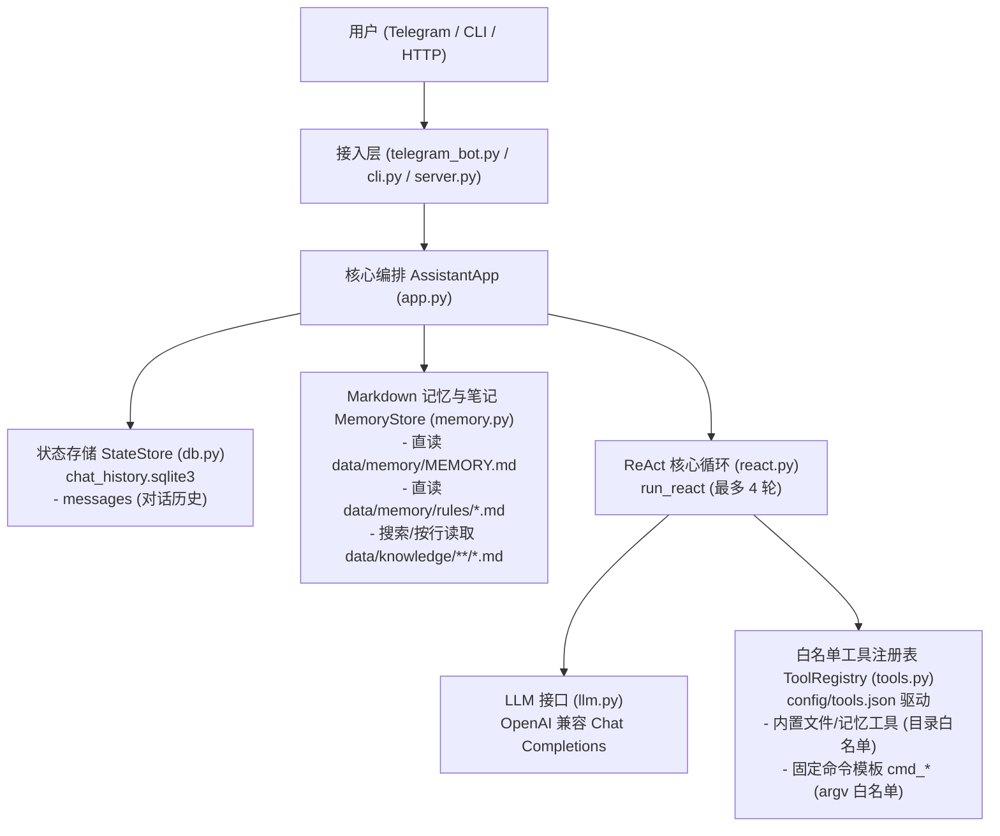

# My Helper v2 — 最小 MVP 设计文档

## 1. 背景与核心目标

原版 `my_helper`（v1）完整保留在 `/Users/crane/my_agent/my_helper` 作为功能沉淀与评测参考，**不做任何删改**。

本项目 `my_helper_v2`（`/Users/crane/my_agent/my_helper_v2`）是从零搭建的**纯 Python 最小 MVP Agent**（预计总代码量 ~900 行，生产零第三方依赖），核心设计原则：

1. **无编译、无后台索引同步**：
   - 不做 LLM Wiki 增量编译、不做后台对话摘要编译、不做 SQLite 向量索引同步，也不设后台 `worker` 进程。
2. **记忆与知识库老老实实直读 Markdown**：
   - **常驻核心记忆（Always-in-Prompt）**：每轮对话直接读取 `data/memory/MEMORY.md`（用户明确要求记住的事实与偏好）与 `data/memory/rules/*.md`（已确认的行为规则），原样注入系统提示词。
   - **按需查阅笔记（On-Demand Markdown Tools）**：`data/knowledge/`（可直接软链接复用 `../my_helper/data/knowledge` 或独立存放）下的所有 Markdown 笔记，由模型按需通过白名单工具（`list_files`、`search_markdown`、`read_markdown`）直接读取源文件。手动编辑 Markdown 即刻生效。
3. **无 MCP，纯原生白名单工具机制**：
   - 不使用 MCP 子进程与动态路由。
   - 所有工具由宿主机纯 Python 原生实现，并通过唯一的配置文件 `config/tools.json` 进行**三级白名单管控**（工具名称白名单、文件读写目录白名单、固定 `argv` 命令模板白名单）。
   - 不设繁琐的二次确认弹窗：凡在白名单且满足目录/参数约束的工具直接执行，白名单外的一切操作直接拒绝。
4. **纯 Python 单服务架构**：
   - 核心聚焦在：对话循环 + Markdown 记忆/知识库 + 本地文件与命令白名单。
   - 使用 Python 标准库实现轻量 Telegram Long Polling 接入层与本地 CLI / HTTP API，单进程即可运行。
   - 后续若需从 v1 迁移课表、论文阅读等能力，只需作为独立白名单工具按需挂载。

---

## 2. 整体架构与目录结构

### 2.1 运行时架构



### 2.2 项目目录结构

```text
my_helper_v2/
├── config/
│   └── tools.json                 # 唯一工具与安全边界白名单配置
├── docs/
│   └── mvp-design.md              # 本设计文档
├── personal_assistant/
│   ├── __init__.py
│   ├── __main__.py                # 启动入口
│   ├── cli.py                     # 命令行入口：serve / telegram / chat (终端交互)
│   ├── app.py                     # AssistantApp：装配、提示词上下文与会话历史 (~120 行)
│   ├── react.py                   # 极简 ReAct 核心循环（最多 4 轮原生工具调用） (~70 行)
│   ├── llm.py                     # OpenAI 兼容 Chat Completions 客户端（标准库 urllib） (~100 行)
│   ├── memory.py                  # Markdown 直读、关键词搜索、按行读取、记忆/规则写入 (~260 行)
│   ├── tools.py                   # Tool 与 ToolRegistry 白名单注册表 (~110 行)
│   ├── commands.py                # 固定 argv 命令模板加载与安全执行器 (~240 行)
│   ├── db.py                      # SQLite 连接与极简表结构（messages） (~60 行)
│   ├── telegram_bot.py            # 纯 Python Telegram Long Polling 与斜杠命令处理 (~150 行)
│   └── server.py                  # 轻量本地 HTTP API (/health, /status, /chat) (~90 行)
├── tests/                         # 面向 MVP 核心闭环的单元测试
├── .env.example
├── .gitignore
├── pyproject.toml
└── README.md
```

### 2.3 数据目录结构（`data/`，不提交 Git，部署不覆盖）

```text
data/
├── memory/
│   ├── MEMORY.md                  # 常驻长期记忆（Markdown 列表，记录用户明确要求记住的事实与偏好）
│   ├── rules/                     # 行为规则（每条一个 .md 文件，可读可直接手改）
│   └── audit.jsonl                # 记忆与文件写入审计日志
├── knowledge/                     # 用户的原始 Markdown 笔记目录（可软链接至 v1 的 data/knowledge）
├── workspace/                     # write_file 唯一允许写入的工作目录（覆盖时自动备份至 .backups/）
└── state/
    ├── chat_history.sqlite3       # 对话历史表 messages
    └── telegram-offset            # Telegram getUpdates 轮询游标
```

---

## 3. 核心模块详细设计

### 3.1 记忆与 Markdown 知识模块（`personal_assistant/memory.py`）

不建数据库索引、不跑后台编译，所有读取直接面向文件系统中的 `.md` / `.txt` 文本文件：

1. **常驻上下文读取（每轮对话自动注入 System Prompt）**：
   - `read_core_memory(max_chars=4000) -> str`：直接读取 `data/memory/MEMORY.md`。若文件不存在则返回空字符串；若超过 `max_chars` 则保留文件头部说明与最近条目并提示可调用 `read_markdown("data/memory/MEMORY.md", ...)` 查看全文。
   - `read_rules_summary(limit=30) -> str`：按文件名倒序读取 `data/memory/rules/*.md`，提取每条规则的 `- Statement:`（或首行标题），拼成 `- data/memory/rules/xxx.md — <规则内容>` 列表。

2. **按需 Markdown 浏览与检索（供白名单工具调用）**：
   - **安全路径解析 `resolve_path(rel_path: str, *, write: bool = False) -> Path`**：
     - 拒绝绝对路径、拒绝 `..`、拒绝包含 `reject_segments`（如 `.env`, `.git`, `state`, `.ssh`, `uploads`）的任何路径段、检查 `resolve()` 后的真实路径属于配置的 `read_roots` 或 `write_root`。
   - **列文件 `list_files(root: str = "data/knowledge", pattern: str = "*.md") -> str`**：
     - 在允许的读取根目录内按 `glob`/`rglob` 匹配文件路径，返回相对路径列表（上限 `max_results=100`），帮助模型先看清目录结构。
   - **搜内容 `search_markdown(query: str, root: str = "data/knowledge") -> str`**：
     - 将 `query` 拆分为非空词项（支持中英文词组与子串），直接扫描目标目录下的 `.md` 文件：
       - 计算每个文件的匹配得分（文件名命中 > 标题行 `#` 命中 > 正文行命中，多词共现加分）。
       - 返回前 `limit=10` 处最佳命中，格式为：
         `path:line [所属小节标题] — 命中行及前后各 2 行上下文`。
       - 遍历单文件时跳过超大二进制或非 UTF-8 文件；对于几百篇个人 Markdown 笔记（数 MB 量级），纯 Python 内存扫描耗时 `< 30ms`。
   - **读原文 `read_markdown(path: str, start_line: int = 1, end_line: int = 120) -> str`**：
     - 读取指定行号范围（单次上限 `max_lines=400`、`max_read_bytes=65536`），输出带行号的原文（`{line_no}: {line}`）及文件总行数提示，方便模型继续翻页。

3. **记忆与规则写入**：
   - `remember_user_statement(user_text: str, message_id: int | None) -> str`：
     - 当用户明确说“记住……”并触发 `remember_fact` 工具时，直接将当前用户原话追加到 `data/memory/MEMORY.md`：
       `- [YYYY-MM-DD HH:MM] (msg#<id>) <用户原话>`
     - 幂等去重（同一 `message_id` 不重复追加），并写入 `data/memory/audit.jsonl`。
   - `save_rule(statement: str, source: str) -> Path`：
     - 当用户确认待生效规则后，写入 `data/memory/rules/<timestamp>-<slug>.md` 并记录 `audit.jsonl`。

---

### 3.2 白名单工具系统（`personal_assistant/tools.py` & `config/tools.json`）

#### 配置文件 `config/tools.json` 格式

```json
{
  "enabled_tools": [
    "list_files",
    "search_markdown",
    "read_markdown",
    "write_file",
    "remember_fact",
    "save_rule"
  ],
  "files": {
    "read_roots": ["data/knowledge", "data/memory", "docs", "data/workspace"],
    "write_root": "data/workspace",
    "max_read_bytes": 65536,
    "max_write_bytes": 65536,
    "max_lines": 400,
    "max_results": 100,
    "reject_segments": [".env", ".git", "state", ".ssh", "uploads"]
  },
  "commands": [
    {
      "name": "git_status",
      "description": "查看项目仓库的未提交改动。",
      "enabled": true,
      "argv": ["git", "status", "--short"],
      "cwd": ".",
      "timeout": 10,
      "max_output_bytes": 8192
    },
    {
      "name": "disk_usage",
      "description": "查看磁盘空间占用。",
      "enabled": true,
      "argv": ["df", "-h"],
      "cwd": ".",
      "timeout": 10,
      "max_output_bytes": 8192
    }
  ]
}
```

#### 内置工具全集（受 `enabled_tools` 白名单开关控制）

| 工具名 | 参数 | 功能说明 |
| :--- | :--- | :--- |
| `list_files` | `root`, `pattern` | 在允许的 `read_roots` 内按 glob 列出文件路径 |
| `search_markdown` | `query`, `root` | 在允许的 `read_roots` 内搜索 Markdown 文件名、标题与正文片段 |
| `read_markdown` | `path`, `start_line`, `end_line` | 按行号读取允许目录下的文本/Markdown 文件 |
| `write_file` | `path`, `content`, `mode` (`create`/`overwrite`) | 仅限写入 `data/workspace/`（覆盖前自动备份到 `.backups/`） |
| `remember_fact` | `{}` (无参数) | 仅在用户明确要求记住信息时调用，程序将本轮用户原话追加至 `data/memory/MEMORY.md` |
| `save_rule` | `statement` | 将用户要求遵守的行为规则写入 `data/memory/rules/`（可由 `enabled_tools` 随时开关） |
| `cmd_<name>` | 配置文件声明的 `params` | 执行 `config/tools.json` 中 `enabled: true` 的固定 `argv` 命令模板，`shell=False` |

#### `ToolRegistry` 纯白名单执行机制

1. **严格白名单过滤**：仅注册 `enabled_tools` 中列出的内置工具及 `commands` 中 `enabled: true` 的命令工具；未在白名单中的工具既不发送给 LLM，也拒绝执行。
2. **参数校验**：检查 JSON 对象、必填字段、类型（含 `enum` 与正则 `pattern`）。
3. **直接执行与错误回传**：校验通过直接运行并在固定字节上限内返回结果；任何参数错误、越界或执行异常直接转成 `"错误：..."` 观察字符串回传模型，不崩溃。

---

### 3.3 对话循环与提示词组装（`personal_assistant/react.py` + `app.py`）

1. **精简 `SYSTEM_PROMPT`**：
   - 你是用户的个人助手，使用简洁自然的中文交流；能力严格以本轮提供的白名单工具为准。
   - 系统提示中已附上用户的 `MEMORY.md`（核心记忆）与 `rules/`（行为规则），必须遵守规则。
   - 回答涉及用户个人笔记或项目文档的问题时，先用 `search_markdown` 或 `list_files` 定位，再用 `read_markdown` 阅读原文段落；基于读到的真实内容回答，没查到就如实说明，绝不编造。
   - 工具调用够用即止（最多 4 轮）。
2. **System Message 结构**：
   ```text
   {SYSTEM_PROMPT}
   今天是 {today}（北京时间）。

   【可用白名单工具】
   {tool_names}

   【行为规则 (data/memory/rules/)】
   {rules_summary or "（暂无规则）"}

   【长期记忆 (data/memory/MEMORY.md)】
   {core_memory or "（暂无记录）"}
   ```
3. **User Message 与历史传递**：
   - 保留 `history_reference`（最近 12 条对话，单条截断 600 字符）+ `current_user_message` 的结构，防止历史拒答污染本轮工具调用。
4. **ReAct 循环（`run_react`，最多 `MAX_TOOL_ROUNDS = 4` 轮）**：
   - 循环调用 `llm.respond(messages, tool_definitions)`；若无 `tool_calls` 则直接返回回复。
   - 否则依次执行工具并将观察字符串以 `role="tool"` 回传。
   - 循环走完 4 轮后摘掉 `tools`（`tools=None`）再调用一次模型总结收尾。

---

### 3.4 状态存储（`personal_assistant/db.py`）

只保留一个 SQLite 数据库文件 `data/state/chat_history.sqlite3`，包含一张表：

```sql
CREATE TABLE IF NOT EXISTS messages (
    id INTEGER PRIMARY KEY AUTOINCREMENT,
    chat_id TEXT NOT NULL,
    role TEXT NOT NULL,
    content TEXT NOT NULL,
    created_at TEXT NOT NULL
);
```

---

### 3.5 纯 Python 接入层（`telegram_bot.py` / `cli.py` / `server.py`）

1. **Telegram Bot（`personal_assistant/telegram_bot.py`）**：
   - 使用标准库 `urllib.request` 直接请求 `https://api.telegram.org/bot<TOKEN>/getUpdates` 与 `sendMessage` / `getFile`（自动继承环境变量 `HTTPS_PROXY` / `HTTP_PROXY`）。
   - 仅响应 `str(message.chat.id) == TELEGRAM_CHAT_ID` 的消息。
   - 支持接收用户直接发送的 `.md` / `.txt` 文档附件，调用 `app.ingest_note(filename, content)` 存入 `data/knowledge/inbox/`。
   - 支持斜杠命令：
     - `/start`, `/help`：显示简洁帮助
     - `/status`：显示 LLM 状态、笔记文件数、记忆条数、已启用白名单工具列表
     - `/memory`：显示 `MEMORY.md` 内容与当前规则列表
     - `/search <关键词>`：不经过 LLM，直接调用 `memory.search_markdown(query)` 返回匹配结果（`LLM_MODE=off` 时依然可用）
   - 普通文本消息直接调用 `app.chat(text, chat_id)`。

2. **统一启动方式（`personal_assistant/cli.py`）**：
   - `uv run python -m personal_assistant serve [--host 127.0.0.1] [--port 8765] [--with-telegram]`：启动 HTTP 服务（可选同进程后台线程跑 Telegram 轮询）。
   - `uv run python -m personal_assistant telegram`：单独在前台运行纯 Python Telegram 轮询。
   - `uv run python -m personal_assistant chat`：在本地终端直接进入 REPL 与助手对话，方便日常调试。

---

## 4. 代码实现步骤（确认本设计文档后按序执行）

1. **Step 1 — 最小 ReAct 核心循环（`personal_assistant/llm.py`, `personal_assistant/tools.py`, `personal_assistant/react.py`, `personal_assistant/cli.py`）**
   - 实现无第三方依赖的 OpenAI 兼容客户端、`Tool` / `ToolRegistry` 最小执行接口，以及清晰直观的 `Reason -> Act -> Observe` 多轮循环（最多 4 轮），支持本地终端 REPL 实时打印工具调用轨迹。
2. **Step 2 — 白名单工具与命令执行器（`config/tools.json`, `personal_assistant/tools.py`, `personal_assistant/commands.py`）**
   - 接入 `enabled_tools` 白名单过滤与 `config/tools.json` 固定 `argv` 命令模板（`shell=False`、环境变量白名单、参数校验、输出截断）。
3. **Step 3 — 纯 Markdown 记忆与知识模块（`personal_assistant/memory.py`）**
   - 直读 `MEMORY.md` 与 `rules/*.md` 注入系统提示词，提供目录白名单内的 Markdown 列表、检索、按行读取与安全写入。
4. **Step 4 — 状态存储与核心编排（`personal_assistant/db.py`, `personal_assistant/app.py`）**
   - 接入 SQLite 会话历史 `messages` 与 `AssistantApp` 装配。
5. **Step 5 — 纯 Python 接入层与完整测试（`personal_assistant/telegram_bot.py`, `personal_assistant/server.py`, `tests/`）**
   - 接入 Telegram Long Polling、轻量本地 HTTP API 与端到端测试。
